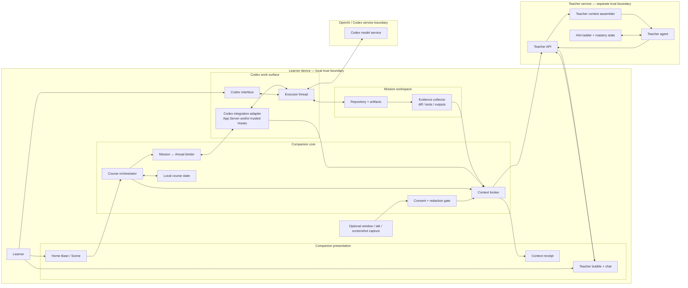
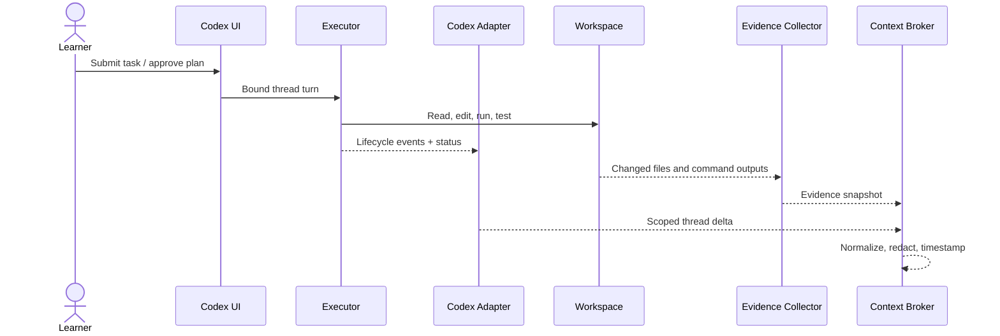
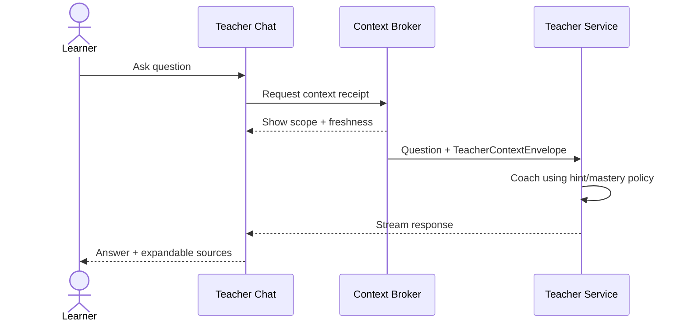
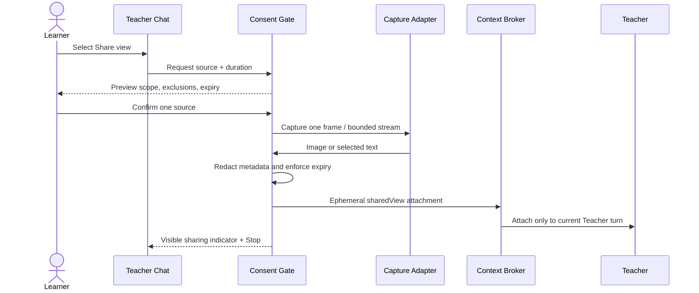

# Course Companion — Technical Architecture and Workflow

**Status:** Proposed MVP architecture
**Date:** 29 July 2026
**Scope:** Course experience only. ContentPilot remains the learner-built product.

## Decision in one sentence

Build the course experience as a local always-on-top companion that explicitly binds each active mission to one Codex Executor `threadId`, assembles a scoped and inspectable Teacher context packet from course state plus Codex/workspace evidence, and treats any tab, window, or screen capture as a separate learner-approved input.

## Plain-language summary

The learner has two helpers:

```text
Ask and learn:   Learner → Course Companion → Teacher
Build and verify: Learner → Codex + Executor → Project Files
```

- The **Teacher** explains, asks questions, gives hints, and checks understanding.
- The **Executor in Codex** edits, runs commands, tests, and reports results.
- The **Learner** decides what to ask, what to approve, and what to do next.
- The course follows one specific Codex conversation so the Teacher receives the correct mission context.
- The Teacher automatically receives mission-relevant progress, not the learner's whole computer.
- Windows, screenshots, unsaved text, and voice require an explicit share action.
- Files, tests, required artifacts, and learner understanding—not the word “done”—complete a mission.

The [interactive collaborator brief](../../prototypes/mvp-3-course-experience-companion/technical-architecture.html) presents this model first and keeps the infrastructure terminology collapsed until requested.

## Why this shape

The learner needs two distinct relationships:

- **Teacher:** explains, diagnoses, hints, and assesses.
- **Executor:** reads, edits, runs, and verifies work inside Codex.

Keeping Codex as the work surface avoids building a second coding client. Keeping the Teacher in the desktop companion preserves course interactivity without turning the Teacher into another Executor.

The key technical constraint is identity. The companion must not guess which Codex conversation is “currently visible.” The mission binds to a specific `threadId`, and every Teacher context update is scoped to that binding.

## System map



## Component responsibilities

| Component | Owns | Must not own |
|---|---|---|
| Home Base / Scene | landing state, authored story, mission entry, debrief | Executor work or free-form plot generation |
| Teacher bubble + chat | text/voice interaction shell, context receipt, minimize/expand behavior | Teacher reasoning or repository tools |
| Course orchestrator | mission state machine, narrative triggers, checkpoint transitions | direct file editing |
| Mission ↔ thread binder | explicit `{courseRunId, missionId, threadId, workspaceRoot}` relationship | inferring focus from a window title |
| Codex integration adapter | normalized thread events, status, turns, approvals, and freshness | deciding mastery |
| Context broker | scoped reads, normalization, provenance, redaction, context budget | silently collecting unrelated activity |
| Teacher context assembler | turn-specific Teacher prompt packet and rolling summary | unrestricted filesystem access |
| Teacher agent | coaching, questioning, hint ladder, assessment | performing the learner's repository task |
| Executor thread | plans and carries out approved repository work | teaching or grading |
| Evidence collector | changed-file metadata, diff summary, command/test results, expected artifacts | treating a chat claim as proof |
| Consent + redaction gate | explicit capture scope, preview, exclusions, expiry, revocation | permanent background surveillance |
| Local course state | mission/checkpoint, narrative progress, bound thread, evidence, mastery | raw secrets or unnecessary full transcripts |

## Codex integration boundary

[Codex App Server](https://developers.openai.com/codex/app-server) is documented as the protocol used to power rich clients. It exposes authentication, conversation history, approvals, and streamed agent events over a bidirectional JSON-RPC interface. That makes it the strongest documented base for a deeply integrated or custom Codex client.

[Codex Hooks](https://learn.chatgpt.com/docs/hooks) can run trusted scripts at lifecycle points such as `SessionStart`, `UserPromptSubmit`, `PreToolUse`, `PermissionRequest`, `PostToolUse`, `Stop`, and `SessionEnd`. That makes hooks a plausible event bridge when the learner uses a native Codex surface.

The MVP architecture therefore defines one replaceable `CodexAdapter` interface:

```ts
interface CodexAdapter {
  bindThread(input: {
    courseRunId: string;
    missionId: string;
    threadId: string;
    workspaceRoot: string;
  }): Promise<ThreadBinding>;

  readThread(input: {
    threadId: string;
    afterCursor?: string;
  }): Promise<ExecutorTurnBatch>;

  subscribe(
    threadId: string,
    onEvent: (event: ExecutorLifecycleEvent) => void,
  ): Unsubscribe;
}
```

### What is documented versus what must be validated

| Item | Confidence | Decision |
|---|---|---|
| App Server can support rich clients, history, approvals, and streamed events | Documented | Use as the primary technical reference |
| Hooks can publish lifecycle events from supported Codex flows | Documented | Evaluate as the native-surface event bridge |
| A stored thread can be read when its ID is known | Documented in App Server thread methods | Persist an explicit `threadId` |
| The companion can discover the currently focused native Codex conversation | Not documented | Do not depend on it |
| The selected desktop Codex surface exposes every event/payload needed by the course | Unknown | Run a technical spike |
| App Server and Hooks identify the same session/thread consistently on the target surface | Unknown | Validate before production estimates |

The [Codex SDK](https://developers.openai.com/codex/sdk) is appropriate for server-side automation, but it does not by itself solve native UI focus, companion overlay, or course-state binding.

## Teacher context contract

The Teacher receives a small, structured packet assembled for the current question. It does not receive an unbounded transcript or filesystem dump.

```json
{
  "schemaVersion": "1.0",
  "course": {
    "courseRunId": "run_01",
    "lessonId": "module-1/lesson-2",
    "missionId": "mission-safe-brief",
    "checkpoint": "evidence_review",
    "objective": "Create a safe, verifiable implementation brief",
    "learnerDecisions": [
      "Do not modify production credentials"
    ]
  },
  "executor": {
    "threadId": "thr_bound_explicitly",
    "status": "waiting_on_learner",
    "latestTurnCursor": "turn_18",
    "recentTurnSummary": "Executor drafted the brief and requested scope approval.",
    "pendingApproval": {
      "kind": "write",
      "summary": "Create docs/implementation-brief.md"
    }
  },
  "workspace": {
    "rootAlias": "active_mission_repo",
    "changedFiles": [
      "docs/implementation-brief.md"
    ],
    "diffSummary": "+42 lines; no code or credential files changed",
    "testResults": [],
    "artifacts": [
      {
        "path": "docs/implementation-brief.md",
        "status": "present"
      }
    ]
  },
  "assessment": {
    "skill": "writing scoped Codex briefs",
    "currentLevel": "guided",
    "hintLevelUsed": 1,
    "unmetCriteria": [
      "Learner must state a verification step"
    ]
  },
  "sharedView": {
    "enabled": false,
    "source": null,
    "expiresAt": null
  },
  "freshness": {
    "courseStateAt": "2026-07-29T10:14:02Z",
    "executorStateAt": "2026-07-29T10:14:00Z",
    "workspaceEvidenceAt": "2026-07-29T10:13:58Z"
  },
  "privacy": {
    "scope": [
      "active course run",
      "explicitly bound Executor thread",
      "mission-relevant workspace evidence"
    ],
    "excluded": [
      "secrets and environment variables",
      "unbound Codex threads",
      "unrelated applications",
      "unsaved editor content unless explicitly shared"
    ]
  },
  "provenance": [
    {
      "field": "executor.status",
      "source": "codex_adapter",
      "capturedAt": "2026-07-29T10:14:00Z"
    },
    {
      "field": "workspace.diffSummary",
      "source": "evidence_collector",
      "capturedAt": "2026-07-29T10:13:58Z"
    }
  ]
}
```

### Default context policy

The Teacher gets automatically:

- active course run, lesson, mission, objective, and checkpoint;
- learner-authored answers and approved decisions;
- identity, status, and scoped recent history of the explicitly bound Executor thread;
- mission-relevant file names, diff summaries, command results, tests, and expected artifacts;
- hint and mastery state;
- timestamps and provenance for every dynamic source.

The Teacher gets only after an explicit share action:

- current window, tab, screenshot, or selected region;
- selected or unsaved editor text;
- voice audio beyond the active push-to-talk/chat session.

The Teacher never gets:

- credentials, tokens, raw environment variables, or secret-store contents;
- unrelated application windows, browser tabs, repositories, or Codex threads;
- an unrestricted workspace archive;
- silent continuous screen capture;
- authority to approve an Executor action on the learner's behalf.

## End-to-end workflows

### 1. Start or resume a mission

```mermaid
sequenceDiagram
  actor L as Learner
  participant UI as Home Base
  participant O as Course Orchestrator
  participant S as Local State
  participant B as Thread Binder
  participant C as Codex Adapter

  L->>UI: Choose current mission
  UI->>O: startOrResume(courseRunId, missionId)
  O->>S: Load checkpoint, narrative, evidence
  O->>UI: Play authored briefing
  L->>UI: Enter Workshop
  O->>B: Require explicit thread binding
  B->>C: Create/select and validate threadId
  C-->>B: Thread identity + workspace root
  B->>S: Persist binding
  O-->>UI: Minimize to Teacher bubble
```



If there is no valid thread binding, the Workshop shows **Connect Executor thread**. The companion does not guess from the frontmost window.

### 2. Learner works with the Executor



The Teacher does not need every token streamed live. The broker keeps a lightweight state snapshot and fetches exact recent turns on demand.

### 3. Learner asks the Teacher



The Teacher may recommend a prompt for Codex, but the learner submits or approves it. The Teacher does not mutate the Executor thread as an invisible side effect of chat.

### 4. Approval, evidence, and mission completion

```mermaid
sequenceDiagram
  participant A as Codex Adapter
  participant UI as Companion
  actor L as Learner
  participant X as Executor
  participant E as Evidence Collector
  participant O as Course Orchestrator
  participant T as Teacher

  A-->>UI: waitingOnApproval
  UI-->>L: Ambient badge; approval stays in Codex
  L->>X: Approve or reject in Codex
  X-->>E: Result, diff, tests, artifact
  E->>O: EvidenceCandidate
  O->>T: Assess against checkpoint rubric
  T-->>O: met / retry + feedback
  alt checkpoint met
    O-->>UI: Trigger authored debrief + room reward
  else retry required
    O-->>UI: Restore Workshop + bounded hint
  end
```

Chat text such as “done” is not sufficient evidence. Completion uses observable artifacts and learner-owned answers against a rubric.

### 5. Explicitly share a window or screenshot



[Appshots](https://learn.chatgpt.com/docs/appshots) are a useful product reference for an explicit, user-triggered capture pattern, but the companion must validate platform support and permissions separately. The architecture does not assume silent cross-platform screen awareness.

### 6. Recovery and degraded mode

| Failure | User-visible state | Recovery |
|---|---|---|
| Bound thread missing or inaccessible | `Executor disconnected` and last-sync timestamp | Rebind a thread; preserve course progress |
| Adapter event stream stops | `Context may be stale` | Poll/read the bound thread if available; otherwise continue without live awareness |
| Teacher service unavailable | Bubble shows offline mode | Codex work continues; queue the question locally only if the user opts in |
| Evidence collector fails | Checkpoint remains pending | Show the missing artifact/test explicitly; never auto-complete |
| Screen permission denied | No shared view | Continue text chat; do not repeatedly prompt |
| Context packet exceeds budget | Receipt shows summarized sources | Keep learner decisions and current evidence; summarize older turns |

## State and event model

```ts
type CourseSurface = "home" | "scene" | "workshop" | "debrief";

type CourseRunState = {
  courseRunId: string;
  lessonId: string;
  missionId: string;
  checkpoint: string;
  surface: CourseSurface;
  narrativeStep: number;
  boundThread?: {
    threadId: string;
    workspaceRoot: string;
    boundAt: string;
    lastVerifiedAt: string;
  };
  evidence: EvidenceRecord[];
  mastery: MasteryState;
  unlockedRoomObjects: string[];
};

type ExecutorLifecycleEvent =
  | { type: "session_started"; threadId: string; at: string }
  | { type: "prompt_submitted"; threadId: string; turnId: string; at: string }
  | { type: "tool_started"; threadId: string; toolKind: string; at: string }
  | { type: "approval_requested"; threadId: string; summary: string; at: string }
  | { type: "tool_completed"; threadId: string; result: "ok" | "error"; at: string }
  | { type: "turn_stopped"; threadId: string; turnId: string; at: string }
  | { type: "session_ended"; threadId: string; at: string };
```

Every dynamic event carries `threadId` and time. Events whose `threadId` does not match the active binding are ignored by the course run.

## Security and privacy boundaries

1. **Local learner device:** companion UI, local course state, Codex surface, workspace, evidence collector, and capture controls.
2. **Teacher service:** receives only the assembled `TeacherContextEnvelope` and the learner's Teacher-chat message.
3. **OpenAI/Codex service:** receives the Executor conversation and repository context according to Codex permissions and sandboxing.
4. **Capture boundary:** remains closed unless the learner selects a source and duration.

The context receipt is a product requirement, not debug UI. It must show:

- active mission and bound thread;
- sources included in the next Teacher message;
- per-source freshness;
- whether any view is being shared;
- exclusions;
- a one-click path to stop sharing or disconnect the thread.

## Recommended MVP slice

### Phase 1 — Prove identity and evidence

- Local desktop companion shell with Home Base, Scene, Workshop bubble, and Teacher Chat.
- One mission and one explicit `threadId` binding flow.
- One `CodexAdapter` technical spike using the target Codex surface.
- Thread status plus recent-turn summary.
- Repository changed-file list, `git diff --stat`, and one deterministic test result.
- Text Teacher chat with a visible context receipt.
- Evidence-gated debrief.

### Phase 2 — Improve continuity

- Resume and reconnect flows.
- Provenance/freshness UI.
- Learner answer and Teacher mastery persistence.
- More mission-specific evidence adapters.

### Phase 3 — Add optional modalities

- Push-to-talk voice.
- Explicit one-frame or bounded-window sharing.
- Capture preview, redaction, expiry, and revocation.

Do not place voice or screen capture on the Phase 1 critical path.

## Technical spike acceptance criteria

Before estimating production integration, demonstrate all of the following on the chosen Codex desktop surface:

1. The companion binds and persists the exact Executor `threadId`.
2. A prompt, tool call, approval request, tool result, stop, and session end are correlated to that same thread.
3. The adapter recovers after Codex or the companion restarts.
4. The companion detects stale context within a defined interval.
5. Events from a second, unbound thread do not enter the Teacher context.
6. No prompt, file content, or environment value is logged outside the declared context policy.

## Open decisions

- Which target surface is first: Codex desktop app, CLI, or IDE extension?
- Does the chosen surface provide sufficient App Server access, Hooks payloads, or both?
- Is Teacher inference local to the companion backend or a hosted course service?
- Which evidence types are required for the first vertical-slice mission?
- How long are Teacher chat summaries, event metadata, and evidence records retained?
- Which desktop wrapper best supports always-on-top, secure local storage, updates, and capture permissions?

These decisions do not change the interaction model. They determine the concrete adapter, packaging, and operational boundary.
