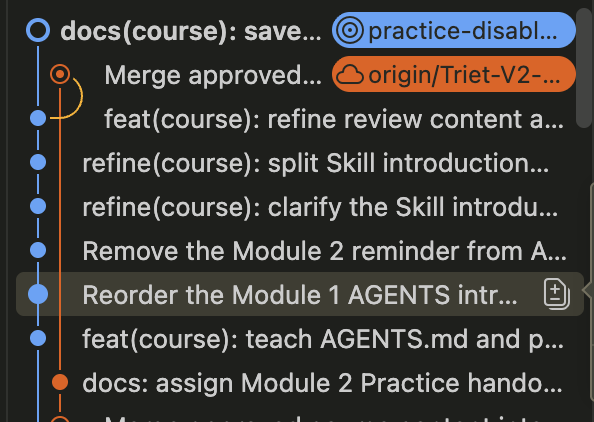

# Module 3 — Bản thiết kế nội dung đang soạn

- **Trạng thái:** Đang lên kế hoạch nội dung
- **Phạm vi:** Nội dung Module 3 dành cho người học
- **Triển khai vào Course Companion:** Chưa bắt đầu theo bản thiết kế này
- **Mức duyệt:** Cấu trúc cốt lõi, thứ tự nội dung và trải nghiệm Practice đã được chủ sở hữu thống nhất; câu chữ của các trang còn lại vẫn phải được bàn lần lượt
- **Nhánh làm việc:** `practice-disabled-content-development`

Tài liệu này lưu lại những nội dung đã bàn để có thể tiếp tục trong một task khác mà không phụ thuộc vào lịch sử hội thoại. Đây chưa phải kịch bản hoàn chỉnh của Module 3 và không thay thế cổng nghiệm thu trong kế hoạch triển khai toàn khóa học.

## 1. Mục đích của Module 3

Module 3 giúp người học chuyển từ một implementation plan đã được duyệt sang một sản phẩm hoạt động được. Người học không giao toàn bộ sản phẩm cho agent trong một prompt lớn. Thay vào đó, họ cùng agent thực hiện từng giai đoạn nhỏ của plan.

Cuối mỗi giai đoạn, agent chạy các kiểm tra phù hợp và trình bày kết quả bằng ngôn ngữ dễ hiểu. Người học xem hành vi thực tế của sản phẩm, đối chiếu với plan rồi mới quyết định có chuyển sang giai đoạn tiếp theo hay không.

Cách làm này có thể lâu hơn việc yêu cầu agent tạo toàn bộ sản phẩm trong một lần. Đổi lại, người học dễ phát hiện khi sản phẩm đi sai hướng, giữ lại những phần đã làm đúng và có nhiều quyền kiểm soát hơn đối với kết quả cuối cùng.

Module này cũng dạy người học cách xử lý lỗi cùng agent và dùng Git như một lớp bảo vệ trong quá trình xây dựng. Portfolio chỉ là sản phẩm thực hành; kỹ năng có thể chuyển sang dự án khác là biết giao việc theo từng phần, kiểm tra kết quả, điều tra lỗi và quay lại một phiên bản ổn định khi cần.

## 2. Nguyên tắc thiết kế đã thống nhất

1. Giới thiệu một khái niệm quan trọng tại một thời điểm; không cần vội.
2. Không giả định người học biết lập trình, terminal, Git, GitHub hoặc repository.
3. Người học đánh giá kết quả qua hành vi quan sát được, ảnh chụp màn hình và phần giải thích dễ hiểu. Không bắt họ đọc code hoặc diff.
4. Khi thực hiện plan, chia sản phẩm thành nhiều giai đoạn nhỏ. Chỉ chuyển sang giai đoạn sau khi giai đoạn hiện tại đã được kiểm tra.
5. Agent thực hiện thao tác kỹ thuật. Người học cần hiểu mục đích và hệ quả để có thể quyết định bước tiếp theo, nhưng không phải ghi nhớ câu lệnh.
6. Tất cả câu hỏi dành cho người học được đặt ở cuối bài, không chen câu hỏi sau từng trang giải thích.
7. Nội dung được bàn và duyệt hết trước khi chỉnh sửa các trang Module 3 trong Course Companion.

## 3. Cấu trúc nội dung hiện tại

Module 3 được chia thành ba phần lớn:

1. **Thực hiện implementation plan theo từng giai đoạn.**
2. **Debug cùng agent khi sản phẩm gặp lỗi.**
3. **Dùng Git và GitHub để lưu phiên bản, khôi phục và thử nghiệm an toàn.**

Người học trước hết hiểu cách chia công việc và kiểm tra từng giai đoạn. Sau đó, debugging được giới thiệu như một phần khó tránh khỏi trong quá trình xây sản phẩm. Git và GitHub xuất hiện sau phần debugging để giúp người học lưu phiên bản, khôi phục và thử nghiệm an toàn. Các câu hỏi tổng kết sẽ được thiết kế sau cùng.

## 4. Thực hiện implementation plan theo từng giai đoạn

### Ý chính đã thống nhất

- Chọn một phần nhỏ trong implementation plan.
- Trước khi làm, xác nhận phạm vi của phần đó và những gì chưa được làm.
- Agent chỉ thực hiện phần đã thống nhất.
- Cuối giai đoạn, agent chạy kiểm tra kỹ thuật và cho người học xem kết quả thực tế.
- Người học đối chiếu kết quả với plan.
- Chỉ khi kết quả đạt yêu cầu mới lưu một phiên bản ổn định và chuyển sang giai đoạn tiếp theo.

### Ví dụ sẽ sử dụng

Không dùng một ví dụ tự nghĩ ra về phần Hero của portfolio. Sử dụng một phần trong implementation plan công khai của dự án CrawlSEO làm ví dụ thực tế:

- Nguồn: [CrawlSEO Phase 1 Implementation Plan](https://github.com/crawlseo/crawlseo/blob/main/PLAN.md)
- Phần minh họa dự kiến: `T1.1 — Initialize Next.js Project`

Nội dung bài học sẽ chỉ ra một task cụ thể trong plan, cách giới hạn phạm vi của task đó và cách kiểm tra kết quả trước khi tiếp tục. Cần phân biệt rõ đâu là nội dung từ nguồn bên ngoài và đâu là cách diễn giải phục vụ bài học.

## 5. Debug cùng agent

### Câu mở đầu đã duyệt nguyên văn

> Okay, bây giờ bạn đã có một implementation plan và bắt đầu thực hiện nó. Đến giai đoạn này, có một điều mình chắc chắn bạn sẽ không thể tránh khỏi. Đó chính là gặp bug (lỗi phần mềm). Hiện tại coding agent chưa phát triển đến mức làm hoàn hảo mọi yêu cầu của bạn mà không có tí lỗi nào.
>
> Thực ra hồi mới bắt đầu code với Coding agents, đâu đó tầm 40% thời gian mình dành để lên kế hoạch và xây sản phẩm thôi, 60% thời gian còn lại mình dành cho debugging (khắc phục lỗi). Thực ra hoàn thành tốt giai đoạn planning và implementation plan đã giúp bạn giảm khá khá bugs rồi. Nhưng vẫn khó tránh khỏi việc bạn sẽ gặp bug trong quá trình xây sản phẩm.
>
> Vậy khi gặp bug thì xử lý thế nào?

### Quy trình dành cho người mới

1. Nếu nhìn thấy lỗi trên màn hình, người học chụp lại màn hình và gửi cho agent để agent điều tra, giải thích rồi sửa.
2. Nếu vẫn chưa tìm được lỗi, yêu cầu agent thêm log và quan sát thông tin xuất hiện trong terminal.
3. Nếu lỗi tiếp tục quay lại sau nhiều lần sửa, yêu cầu agent tạm dừng và liệt kê các nguyên nhân có thể xảy ra.

Quy trình này phải được trình bày như một cách làm thực tế, dễ nhớ. Không biến phần mở đầu thành một quy trình điều tra kỹ thuật phức tạp.

### Câu chữ đã thống nhất

#### Yêu cầu AI liệt kê các nguyên nhân có thể xảy ra

Nếu lỗi vẫn quay lại sau nhiều lần sửa, hãy yêu cầu AI tạm dừng và liệt kê những nguyên nhân có thể khiến lỗi xảy ra. Cách này giúp quá trình điều tra có hệ thống hơn và thường tìm ra nguyên nhân gốc, thay vì chỉ vá những biểu hiện trước mắt.

### Điều người học cần hiểu

Agent có thể thực hiện phần lớn việc debug, nhưng người học vẫn cần biết lỗi nhìn thấy là gì, agent đã dựa vào thông tin nào và kết quả sau khi sửa có thực sự giải quyết lỗi hay không.

### Câu chuyển sang Git đã duyệt nguyên văn

> Trong quá trình debugging, có thể bạn sẽ cần phải khôi phục phiên bản trước khi có lỗi, để xem lỗi nằm ở đâu. Đó là lúc Git có tác dụng

## 6. Git và GitHub

Git và GitHub sẽ có một cụm trang riêng. Nội dung không bị nhét vào một trang dài.

Cụm năm trang này nằm sau phần debug cùng agent.

### Thứ tự trang đã thống nhất

| Trang | Chủ đề | Trạng thái nội dung |
| --- | --- | --- |
| 1 | Vì sao cần Git? | Đã thống nhất định hướng và câu giải thích về “phân tán” |
| 2 | Git khác GitHub như thế nào? | Đã thống nhất định hướng và cách giải thích đơn giản |
| 3 | Commit: lưu một phiên bản của dự án | Đã duyệt |
| 4 | Push: đưa commit lên GitHub | Đã duyệt |
| 5 | Branch: thử nghiệm mà không ảnh hưởng phiên bản ổn định | Đã duyệt |

Commit phải được giới thiệu trước push.

### Trang 1 — Vì sao cần Git?

Mục đích của trang này là giới thiệu Git như một công cụ giúp người học lưu lịch sử và có đường quay lại khi công việc sau đó gây lỗi. Đây chưa phải bài học về câu lệnh hoặc cộng tác nhóm.

Git là một hệ thống quản lý phiên bản phân tán. Hệ thống quản lý phiên bản giúp ghi lại những thay đổi của dự án theo thời gian và cho phép quay lại một phiên bản trước đó khi cần.

Đoạn giải thích đã được duyệt nguyên văn:

> “Phân tán” có nghĩa là repository trên máy tính của bạn không chỉ giữ phiên bản mới nhất, mà còn có lịch sử của dự án. Bạn có thể thấy được tất cả phiên bản cũ mà bạn từng làm, cũng như các phiên bản mà hiện tại bạn đang phát triển.

Khái niệm `repository` phải được giải thích bằng ngôn ngữ đơn giản trước hoặc ngay khi người học cần hiểu nó.

### Trang 2 — Git khác GitHub như thế nào?

Câu mở đầu đã được duyệt nguyên văn:

> Git và GitHub thường được nhắc đến cùng nhau, nhưng thực ra chúng là hai khái niệm khác nhau.

Hướng giải thích hiện tại:

Git là một hệ thống hoạt động trên máy tính. Git theo dõi các tệp trong dự án và lưu lại lịch sử thay đổi của chúng.

Nơi Git quản lý các tệp cùng lịch sử thay đổi được gọi là repository, hay kho lưu trữ dự án. Bạn có thể dùng Git trên máy tính mà không cần kết nối với GitHub.

GitHub là một nền tảng trực tuyến. Bạn có thể đưa repository từ máy tính lên GitHub để lưu một bản trên mạng. Sau đó, bạn có thể truy cập dự án từ máy khác hoặc chia sẻ với người khác.

GitHub cũng cung cấp các công cụ giúp mọi người cùng thảo luận và quản lý công việc. Vì vậy, GitHub làm được nhiều việc hơn một máy chủ chỉ dùng để lưu Git repository.

### Trang 3 — Commit: lưu một phiên bản của dự án

Nội dung và ảnh minh họa dưới đây đã được duyệt.

Khi bạn thay đổi các tệp trong một repository, Git chưa tự coi những thay đổi đó là một phiên bản đã hoàn thành. Khi dự án đạt đến trạng thái mà bạn muốn lưu lại, bạn có thể tạo một commit.

Commit là một phiên bản của dự án được lưu trong lịch sử Git. Nó ghi lại trạng thái của dự án tại thời điểm đó và đi kèm một lời nhắn ngắn để mô tả thay đổi. Nhiều commit nối tiếp nhau tạo thành lịch sử của dự án.

Chú thích đi cùng ảnh:

> Mỗi dòng trong hình là một commit. Các commit nối tiếp nhau cho thấy dự án đã được lưu lại qua nhiều phiên bản.

Ở trang này, người học chỉ cần chú ý đến danh sách commit và thứ tự của chúng. Chưa giải thích các đường màu, nhãn branch hoặc nhãn `origin/...` xuất hiện trong hình.

Một commit được lưu trong repository trên máy tính của bạn. Nó không tự động xuất hiện trên GitHub.

Nếu muốn lưu các commit trên GitHub, bạn cần thực hiện một bước riêng. Trang tiếp theo sẽ giải thích bước đó.

### Trang 4 — Push: đưa commit lên GitHub

Trang này nối trực tiếp với commit đã được tạo trên máy tính.

Push là thao tác gửi những commit mới từ repository trên máy tính lên repository của cùng dự án trên GitHub.

Sau khi push thành công, các commit đó sẽ xuất hiện trong lịch sử dự án trên GitHub. Push không tạo commit mới; nó chỉ đưa những commit đã có trên máy tính lên GitHub.

Phần này không giới thiệu câu lệnh, remote hoặc `origin`. Agent sẽ xử lý các thao tác kỹ thuật.

Việc giới thiệu push không có nghĩa là sau mỗi giai đoạn đều phải đưa commit lên GitHub. Push là một hành động đưa dữ liệu ra ngoài và được xử lý riêng, thay vì tự động trở thành một bước trong mỗi vòng triển khai.

### Trang 5 — Branch: thử nghiệm mà không ảnh hưởng phiên bản ổn định

Nội dung dưới đây đã được duyệt:

Bây giờ, giả sử bạn đang phát triển một tính năng mới. Bạn chưa chắc mình có muốn đưa tính năng đó vào sản phẩm hay không, nhưng vẫn muốn thử nghiệm thêm.

Bạn không nên thử trực tiếp trên phiên bản đang hoạt động ổn định. Những thay đổi chưa hoàn thiện có thể làm hỏng phần đang hoạt động tốt.

Đây là lúc bạn có thể dùng branch. Branch là một hướng phát triển riêng trong cùng repository. Nó cho phép bạn thử nghiệm tính năng mới mà chưa làm thay đổi phiên bản ổn định.

Sau khi thử nghiệm, bạn xem kết quả rồi quyết định có đưa tính năng vào phiên bản ổn định hay không. Agent sẽ thực hiện phần kỹ thuật sau khi bạn lựa chọn.

## 7. Practice

### Hành trình của người học

Practice là một quá trình làm việc liên tục, không được trình bày cho người học như năm milestone riêng biệt.

Người học bắt đầu từ planning và implementation plan đã duyệt, sau đó làm việc trực tiếp với Codex trong cùng một task để xây website. Codex tiếp tục thực hiện plan, kiểm tra kết quả và nhận phản hồi cho đến khi người học hài lòng với website hiện tại.

Nếu gặp lỗi trong quá trình xây, người học hỏi ngay Codex trong task đang thực hiện. Codex đã có bối cảnh của website, biết thay đổi vừa làm và có thể kiểm tra trực tiếp trong workspace. Teacher không mở một cuộc điều tra lỗi song song.

### Vai trò của Teacher trong Practice

Trong khi Practice đang hoạt động, Teacher không hiển thị ô chat. Khu vực Teacher chỉ có hai nút:

1. **Hoàn thành bài**
2. **Xem lại objective của bài**

Nút **Hoàn thành bài** bắt đầu bước review cuối, không tự động đánh dấu bài đã đạt. Course Companion kiểm tra bằng chứng hiện tại. Nếu còn thiếu, giao diện nói ngắn gọn điều chưa đạt và đưa người học trở lại task Codex. Nếu đã đủ, người học xác nhận chấp nhận website hiện tại rồi kết thúc Practice.

Nút **Xem lại objective của bài** mở một bảng nhỏ nhắc lại mục tiêu của Practice, implementation plan đang được thực hiện và điều kiện để kết thúc. Nút này không mở Teacher chat và không tạo một cuộc hội thoại mới.

Teacher chỉ trò chuyện với người học trong phần bài học trước Practice và phần review sau Practice. Trong lúc xây website, Codex là nơi duy nhất người học trao đổi về công việc và lỗi của sản phẩm.

### Ranh giới với runtime hiện tại

Practice runtime hiện tại vẫn dùng năm milestone và các artifact kỹ thuật cũ. Quyết định trong tài liệu này chưa thay đổi runtime, Course Companion hoặc code. Khi toàn bộ content Module 3 được duyệt, phần triển khai sau đó phải đơn giản hóa trải nghiệm người học theo thiết kế này mà vẫn giữ việc kiểm tra bằng chứng ở phía sau.

## 8. Những nội dung chưa chốt

- Các câu hỏi tổng kết đặt ở cuối bài.
- Câu chữ đầy đủ cho phần thực hiện implementation plan theo từng giai đoạn.
- Câu chữ đầy đủ cho các bước debugging sau đoạn mở đầu đã duyệt.
- Câu chữ cuối cùng của Trang 1 và Trang 2 trong cụm Git và GitHub.
- Cách Course Companion diễn đạt kết quả review khi người học bấm **Hoàn thành bài**.
- Giá trị viewport desktop và mobile dùng thống nhất trong hướng dẫn và kiểm tra.

Không được coi các mục này là đã được chủ sở hữu duyệt.

## 9. Nguồn tham khảo

Nguồn chính thức dùng để kiểm tra khái niệm:

- [OpenAI — Introducing Codex](https://openai.com/index/introducing-codex/)
- [Git — About Version Control](https://git-scm.com/book/en/v2/Getting-Started-About-Version-Control)
- [Git — What is Git?](https://git-scm.com/book/en/v2/Getting-Started-What-is-Git%3F)
- [Git — Branches in a Nutshell](https://git-scm.com/book/en/v2/Git-Branching-Branches-in-a-Nutshell)
- [Git — git-restore](https://git-scm.com/docs/git-restore)
- [GitHub — What is GitHub?](https://docs.github.com/en/get-started/start-your-journey/what-is-github)
- [GitHub — About remote repositories](https://docs.github.com/en/get-started/git-basics/about-remote-repositories)
- [GitHub — About repositories](https://docs.github.com/en/repositories/creating-and-managing-repositories/about-repositories)

Nguồn bổ sung do người dùng cung cấp:

- [Git Tutorial P1 trên Viblo](https://viblo.asia/p/git-tutorial-p1-5y8Rr7oAMob3)

Bài Viblo được dùng để tham khảo danh sách khái niệm cần thiết, không dùng làm nguồn duy nhất cho câu lệnh hoặc hành vi hiện tại của Git.

## 10. Bước tiếp theo được phép

Tiếp tục bàn và duyệt lần lượt các nội dung còn thiếu trong Mục 8. Chưa chỉnh sửa Course Companion hoặc Practice runtime. Chỉ bắt đầu xây Module 3 sau khi toàn bộ content của module được chủ sở hữu duyệt.
