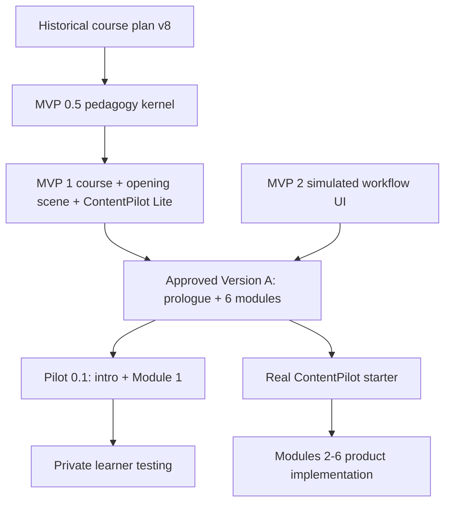

# UI, UX, and Course Interaction Review Index

**Audit date:** 28 July 2026
**Scope:** Course-learning experience, ContentPilot product experience, visual
prototypes, interaction rules, learner state, assessment behavior, and
implemented UI surfaces in this repository
**Method:** Repository source audit. This document distinguishes written plans
from implemented behavior and does not claim a live-browser usability test.
**Authority fix:** Resolved on 28 July 2026. Root course skills now delegate
exclusively to Pilot 0.1; root guidance labels `prototypes/` as historical.

## Executive summary

This repository contains three different kinds of experience:

1. **The current private course pilot:** a Codex-native, conversational learning
   experience in `pilot-workspace/`. It includes the intro and Module 1 only.
2. **The ContentPilot application:** a real Next.js starter with a responsive
   shell and honest empty states. The final research-to-export workflow is
   planned but not yet implemented.
3. **Earlier prototypes:** a pedagogy kernel, an older four-module course,
   ContentPilot Lite, an RPG-style opening scene, and a simulated workflow UI.
   They remain useful references but are not the current product.

The strongest current interaction decisions are:

- Vietnamese-first teaching with one main question or action per turn.
- Learner ownership of goals, approvals, acceptance, and consequential choices.
- Prediction before execution, evidence after execution, and a staged hint
  ladder before worked answers.
- Local checkpoints and resumable lesson state.
- One obvious primary product action, progressive disclosure, explicit human
  review, and no automatic publishing.
- Honest empty states instead of simulated product progress in the real starter.
- Visible cost estimates and intentional confirmation before paid or expensive
  operations in the future workflow.

The audit originally found **source-of-truth ambiguity**: root skills launched
the older MVP 1 course while `pilot-workspace/` launched Pilot 0.1. That routing
problem is now resolved:

- Root `$start-course-lesson` and `$course-teacher` delegate exclusively to
  `pilot-workspace/`.
- Root `README.md` and `AGENTS.md` identify Pilot 0.1 as the only runnable
  course, `docs/planning/` as the public-course plan, and `prototypes/` as
  historical reference.
- Pilot fallback instructions and its mastery rubric now lead from intro to
  Module 1 rather than stale Module 0 behavior.
- The local learner-state example now matches the runtime checkpoint shape.

The older 13-module plan and MVP 1 assets remain available for design research,
but they no longer participate in current lesson resolution.

## Authority map

| Evidence layer | Status | What it should govern |
|---|---|---|
| [Planning handoff](./content-automation-course-handoff.md) | Current planning snapshot | Overall product, course, starter, pilot, cost, and graduation status |
| [Version A curriculum](./version-a-curriculum-blueprint.md) | Approved public-course direction | Prologue + six-module learner progression |
| [Starter progression](./starter-repository-progression-v1.md) | Locked implementation contract | Screen, route, component, and behavior progression from starter to graduation |
| [Artifact and run-state contract](./artifact-schema-and-run-state-v1.md) | Locked state contract | Workflow states, transitions, revisions, reruns, and recovery |
| [Graduation assessment](./graduation-assessment-v1.md) | Locked assessment contract | Evidence gates, defense, scoring, and resubmission |
| [Pilot 0.1 start page](../../pilot-workspace/START_HERE.md) and [course map](../../pilot-workspace/course/course-structure.json) | Current private-pilot runtime | The actual intro + Module 1 learner experience |
| [Real starter README](../../starters/contentpilot/README.md) and source | Current implemented product baseline | The UI and behavior that exist before learners build product features |
| [MVP 2 workflow prototype](../../prototypes/mvp-2-content-workflow-prototype/README.md) | Disposable visual reference | General visual direction and simulated review interaction |
| [MVP 1 course repo](../../prototypes/mvp-1-course-repo/README.vi.md) | Superseded curriculum prototype | Reusable scripts, lessons, quizzes, opening scene, and ContentPilot Lite |
| [MVP 0.5 pedagogy kernel](../../prototypes/mvp-0.5-pedagogy-kernel/README.vi.md) | Legacy behavior research | Teacher interaction patterns and early learner-state design |
| [Course plan v8](../../codex_content_creator_course_plan_v8.html) | Historical strategy document | Original 13-module plan and proposed visual learning shell |



## Recommended review order

Use this order to avoid reviewing a prototype as if it were current behavior:

1. Read this index.
2. Read the [planning handoff](./content-automation-course-handoff.md).
3. Review the [Pilot 0.1 start page](../../pilot-workspace/START_HERE.md),
   [course map](../../pilot-workspace/course/course-structure.json), and both
   current lesson scripts.
4. Review the current Teacher and start-course skills inside
   `pilot-workspace/.agents/`.
5. Review the real starter’s four visible routes and CSS.
6. Review the Version A curriculum and starter progression for the intended
   Modules 2–6 experience.
7. Review the artifact state machine and graduation assessment.
8. Open the simulated MVP 2 workflow UI only as a visual reference.
9. Review MVP 1 and MVP 0.5 only for reusable interaction ideas.
10. Review plan v8 last as historical context.

## 1. Current Pilot 0.1 learner journey

The current private pilot is not a separate learning website. The learner opens
the downloaded workspace in Codex and uses a project-local skill to start or
resume a conversation. The same workspace also contains the ContentPilot app.

### End-to-end interaction

| Stage | Learner action | Teacher or system response | Persistent evidence |
|---|---|---|---|
| Activate | Open the workspace and enter `$start-course-lesson intro` | Resolve the local course map and begin the first scripted beat | State is created after the first completed checkpoint |
| Set pace | Choose 10, 20, 30, 45, or 60 minutes | Record the budget and set an appropriate stopping point | `timeBudgetMinutes` |
| See the goal | Explain what must remain a human decision in the final workflow | Introduce 10 ideas, 5 selected packages, human review, and real-API graduation | `intro-graduation` checkpoint |
| Ground the course | Name a real weekly content bottleneck and primary platform | Ask one clarification only if the problem is too broad | Problem and platform checkpoints |
| Create ownership artifact | Write a personal quest card with an observable success criterion | Ask permission before creating the artifact file | `artifacts/quest-card.md` |
| Readiness gate | Answer two questions one at a time | Give short feedback; require learner-owned wording | `intro-readiness` checkpoint |
| Transition | Start Module 1 | Move to safe repository work in the real starter | `intro-complete` |
| Predict | Predict which files control welcome content and mobile behavior | Treat the answer as a prediction, not a graded test | `m1-orient` |
| Establish baseline | Approve dependency installation if required, then run checks | Keep inspection read-only until approval; fix a broken baseline before the lab | `m1-baseline` |
| Inspect | Write a scoped read-only request | Execute the learner’s request and return file-based evidence | `m1-inspect` |
| Create durable guidance | Decide what belongs in `AGENTS.md` | Propose a small patch and wait for approval | `m1-guidance` |
| Write the brief | Define goal, scope, constraints, non-goals, and done-when | Require a 54px mobile target, full-width mobile action, no overflow, and unchanged desktop behavior | `m1-brief` |
| Approve the plan | Review files, operations, risks, and verification | Do not edit until approval is explicit | `m1-plan-approval` |
| Build | Let Codex change only the approved files | Run the complete check and inspect desktop plus narrow mobile UI | `m1-build` |
| Accept or revise | Review diff, automated output, and manual UI behavior | Ask the learner to accept or request a repair with a reason | `artifacts/module-1-evidence.md` and `m1-review` |
| Mastery | Answer five transfer questions one at a time | Give a focused repair when evidence is incomplete | `m1-mastery` |
| Complete | Finish the pilot | Mark Module 1 complete without implying Modules 2–6 exist | `m1-complete` |

Primary sources:

- [Intro script](../../pilot-workspace/course/lesson-scripts/intro.script.vi.md)
- [Module 1 script](../../pilot-workspace/course/lesson-scripts/module-1.script.vi.md)
- [Intro quiz](../../pilot-workspace/course/quizzes/intro.quiz.json)
- [Module 1 quiz](../../pilot-workspace/course/quizzes/module-1.quiz.json)

### Conversation UX contract

The course treats dialogue behavior as part of the interface:

- One main question or learner action per turn.
- Scripted learner-facing lines are used before improvisation.
- Internal bracketed instructions and assessment logic are never narrated.
- The Teacher asks the learner to predict before inspection or execution.
- A graded question stays open until its evidence requirement is satisfied.
- Clarification may restate goal, context, constraints, output, and success
  criteria, but it must not reveal the answer.
- Copied course wording is not accepted as learner evidence.
- Off-script answers should acknowledge, respond in 1–3 sentences, and return to
  the current learning step.
- The hint ladder moves from diagnosis to Socratic question, light hint,
  partial example, and finally a worked answer.
- After a worked answer, the learner must retrieve or explain the concept again.
- The Learner owns goal, approval, acceptance, and external actions.
- The Teacher coaches and assesses.
- The Executor reads or changes the repository only within the authorized scope.

Primary sources:

- [Teacher system prompt](../../pilot-workspace/course/pedagogy/teacher/teacher-system-prompt.vi.md)
- [Scripted delivery contract](../../pilot-workspace/course/pedagogy/teacher/scripted-delivery-contract.vi.md)
- [Hint ladder](../../pilot-workspace/course/pedagogy/rubrics/hint-ladder.vi.md)
- [Quiz protocol](../../pilot-workspace/course/pedagogy/rubrics/quiz-delivery-protocol.vi.md)
- [Mastery rubric](../../pilot-workspace/course/pedagogy/rubrics/mastery-rubric.vi.md)
- [Course Teacher skill](../../pilot-workspace/.agents/skills/course-teacher/SKILL.md)

### Resume and checkpoint behavior

The [course-state helper](../../pilot-workspace/.agents/skills/start-course-lesson/scripts/course-state.mjs)
supports:

- `show`: return the current lesson, beat, time budget, and completion data.
- `checkpoint`: atomically add a completed beat and advance the current beat.
- `complete`: reject lesson completion when required checkpoints are missing,
  then advance to the next lesson when one exists.

The state is local, ignored by Git, written with file mode `0600`, and replaced
atomically through a temporary file and rename.

Current state UX limitations:

- There is no learner-facing progress screen; progress is visible only through
  conversation or JSON command output.
- The helper does not enforce checkpoint order.
- Completion checks checkpoint presence but does not itself verify that the
  required artifact file or mastery evidence exists.
- The helper resolves the workspace from the current working directory, while
  the skill describes locating the nearest valid workspace ancestor. The skill
  must ensure the command runs from the workspace root.
- The time budget is stored, but Module 1 does not yet provide a formal
  budget-to-beat scheduling table.

## 2. Current implemented ContentPilot UI

The real starter appears twice:

- `starters/contentpilot/` is the validated baseline.
- `pilot-workspace/contentpilot/` is the copy shipped in Pilot 0.1.

They are identical except for the Module 1 exercise: the pilot copy intentionally
omits the narrow-mobile full-width rule for the primary action so the learner
can implement it.

### Screen inventory

| Route | Current UI | Current interaction | Status |
|---|---|---|---|
| `/` | Welcome message, local-workspace explanation, one primary action, and a “nothing generated yet” note | `Bắt đầu thiết lập` navigates to `/setup` | Implemented |
| `/setup` | Honest empty state | No form or persistence yet | Implemented shell; Module 2 behavior absent |
| `/workflow` | Honest empty state | No research, ideas, drafts, progress, or generation | Implemented shell; Modules 3–5 behavior absent |
| `/review` | Honest empty state | No packages, revisions, approvals, archive, or export | Implemented shell; Module 5 behavior absent |
| `/api/health` | Non-sensitive readiness response | Does not require an API key | Implemented |

Primary sources:

- [App shell](../../starters/contentpilot/components/AppShell.tsx)
- [Empty-state component](../../starters/contentpilot/components/EmptyState.tsx)
- [Welcome page](../../starters/contentpilot/app/page.tsx)
- [Setup page](../../starters/contentpilot/app/setup/page.tsx)
- [Workflow page](../../starters/contentpilot/app/workflow/page.tsx)
- [Review page](../../starters/contentpilot/app/review/page.tsx)
- [Global UI styles](../../starters/contentpilot/app/globals.css)

### Navigation and visual design

- Sticky top navigation: `Bắt đầu`, `Thiết lập`, `Workflow`, `Duyệt bài`.
- Active navigation is derived from the route and exposed through
  `aria-current="page"`.
- Visual direction: warm neutral canvas, paper surfaces, dark ink, restrained
  coral accent, rounded controls, quiet editorial spacing.
- The welcome page has one prominent action rather than a dashboard of controls.
- Empty states use a single shared component and do not imply completed work.
- The app supports focus-visible styling.
- Reduced-motion preferences shorten transitions.
- The layout starts at a 320px minimum width.
- At 640px and below, navigation scrolls horizontally and content becomes
  single-column.
- In the validated starter, the primary action becomes full-width on mobile and
  keeps the arrow on the far edge.

### Module 1 responsive lab

The exact behavioral difference is:

```css
@media (max-width: 640px) {
  .primary-action {
    width: 100%;
    justify-content: space-between;
  }
}
```

That rule exists in `starters/contentpilot/app/globals.css` and is intentionally
absent from `pilot-workspace/contentpilot/app/globals.css`.

The learner must preserve:

- the `/setup` destination,
- a minimum 54px tap target,
- full-width action at narrow mobile widths,
- arrow alignment at the far edge,
- content-width action on desktop,
- no horizontal overflow,
- no unrelated file changes.

## 3. Planned graduation-product UX

The final application is a local, private, real-API content workflow. It does
not require accounts, cloud storage, deployment, scheduling, or publishing for
graduation.

### Primary workflow

```text
Onboarding
  → voice analysis
  → cited research
  → accepted evidence
  → 3-5 patterns
  → 10 ideas
  → 5 learner selections
  → 5 editable copy packages
  → 2 visual variants per package
  → human review
  → approval
  → local archive
  → export
```

### Intended interaction by module

| Stage | Planned learner-facing interaction |
|---|---|
| Brand setup | Complete required brand, niche, audience, platform, cadence, and five-example inputs; known competitors remain optional; save, reload, and create new revisions when editing |
| Voice analysis | Intentionally start a real server-side analysis, inspect a concise validated profile, trace observations to writing samples, and recover without overwriting the last valid profile |
| Research | Start a schedule-aware run, open visible citations, distinguish direct competitor evidence from supporting context, and preserve excerpts or screenshots |
| Source review | Accept, reject, or flag sources with reasons; unsupported and unverifiable evidence cannot influence patterns |
| Pattern review | Inspect 3–5 traceable patterns, confidence, freshness, and anti-copy reasoning; show `needs_more_research` instead of inventing filler |
| Idea selection | Compare exactly 10 ideas through visible platform fit, voice fit, evidence support, and variety; challenge scores and intentionally select 5 |
| Drafting | Edit copy directly, request a bounded revision for one package, preserve approved parts, and keep sources attached |
| Visual generation | Review a creative brief, approve likeness use per attempt, generate two meaningfully different variants, and recover from partial failures |
| Package review | See copy, both visuals, sources, edits, and approval state on one screen; choose a visual, revise, and approve explicitly |
| Archive and export | Reopen immutable approved packages and export final copy, selected image, source notes, and suggested publishing date |
| Recovery | See exact blocked, stale, failed, or missing-evidence reasons; rerun one phase without deleting valid work |
| Graduation | Submit a real run, verification output, one recovery or revision example, and answer defense questions one at a time |

Primary sources:

- [Version A curriculum blueprint](./version-a-curriculum-blueprint.md)
- [Starter repository progression](./starter-repository-progression-v1.md)
- [Artifact and run-state contract](./artifact-schema-and-run-state-v1.md)
- [Graduation assessment](./graduation-assessment-v1.md)

### Planned screen and component surface

The current progression contract names these future surfaces:

- `/setup`
  - `BrandSetupForm`
  - `VoiceAnalysisPanel`
- `/workflow/[runId]`
  - `RunWorkspace`
  - `EvidencePanel`
  - `SourceReviewPanel`
  - `PatternsPanel`
  - `IdeasPanel`
  - `DraftsPanel`
  - `VisualsPanel`
  - `LikenessConsent`
  - `RecoveryPanel`
- `/review/[runId]`
  - `PackageReview`
  - `RevisionControls`
- `/archive`
- run-specific API routes for research, source decisions, patterns, ideas,
  selections, drafts, visuals, review, archive, export, and rerun.

These are planned responsibilities, not current components.

### Product state and recovery UX

The final interface must derive phase state from `run.json`, validated artifacts,
input references, and attempt records:

| State | Meaning | Required UI response |
|---|---|---|
| `blocked` | An upstream phase is not ready | Name the exact missing or stale dependency |
| `not_started` | Inputs are ready but no attempt exists | Offer the start action |
| `running` | Latest attempt is executing | Show subordinate progress without hiding existing usable work |
| `needs_review` | A valid candidate exists but is not active | Let the learner inspect, accept, or reject it |
| `needs_revision` | The latest candidate was rejected and no fallback is active | Show the rejection reason and bounded retry |
| `needs_more_research` | Fewer than three qualified patterns exist | Explain what evidence is missing |
| `ready` | A valid active artifact matches current inputs | Present current usable output |
| `stale` | An upstream active revision changed | Name which revision changed and require an intentional rerun |
| `failed` | No usable active artifact exists and the latest attempt failed | Show the error and recovery action |

If an experimental rerun fails while an older active artifact remains usable,
the phase stays `ready` and shows a secondary failure notice.

### Cost, consent, and external-effect UX

- Show an estimated cost range before a run and before visual generation.
- State the assumptions and explain that actual cost can vary.
- Do not impose a mandatory beginner spending ceiling.
- Require intentional confirmation for duplicate submissions and expensive
  downstream reruns.
- Preserve every valid artifact when an operation is stopped, rejected, or
  fails.
- Require per-attempt approval before using a learner’s likeness.
- Stop before publishing; nothing is automatically scheduled or published.

## 4. Visual and interaction prototypes

### MVP 2 simulated workflow UI

Sources:

- [Prototype overview](../../prototypes/mvp-2-content-workflow-prototype/README.md)
- [HTML](../../prototypes/mvp-2-content-workflow-prototype/index.html)
- [Interaction code](../../prototypes/mvp-2-content-workflow-prototype/app.js)
- [Styles](../../prototypes/mvp-2-content-workflow-prototype/styles.css)

Demonstrated screens:

- **Hôm nay:** weekly-batch context, one workflow action, five-stage progress,
  and a research signal.
- **Thiết lập:** niche, optional competitors, visual styles, cadence, and save
  action.
- **Duyệt bài:** five-package index, editable copy, two visual options, evidence
  dialog, revision request, and approval.

Demonstrated interactions:

- Switch between three in-page views.
- Simulate five generation stages.
- Toggle visual-input choices.
- Submit setup and return to Today.
- Select packages, directly edit displayed copy, and choose visual A or B.
- Request revision through `window.prompt`.
- Approve a package and automatically move to the next pending package.
- Open and dismiss a simulated evidence dialog.
- Collapse the review index into a horizontal package list on mobile.
- Keep review actions sticky at the bottom on mobile.

Important limitations:

- All data, progress, dates, evidence, scores, and outputs are simulated.
- Setup values and visual-input choices are not persistently stored.
- Direct copy edits are lost when `renderReview()` runs again.
- The selected visual is global rather than stored per package.
- Approval does not enforce a persisted copy, selected visual, source review, or
  closed revision request.
- The evidence dialog shows the same three hard-coded items for every package
  and provides no source links.
- The “Xem nguồn nghiên cứu” action routes to the review view rather than opening
  source evidence.
- The mobile layout hides the evidence toggle, making source evidence
  inaccessible from that route at narrow widths.
- The prototype shows a provider/model label but no cost estimate or paid-run
  confirmation.
- It is a visual-direction reference, not a behavioral specification.

### MVP 1 RPG-style opening scene

Sources:

- [Visual novel script](../../prototypes/mvp-1-course-repo/visuals/opening-scene/visual-novel-script.vi.md)
- [HTML](../../prototypes/mvp-1-course-repo/visuals/opening-scene/index.html)
- [Interaction code](../../prototypes/mvp-1-course-repo/visuals/opening-scene/app.js)
- [Styles](../../prototypes/mvp-1-course-repo/visuals/opening-scene/styles.css)

Demonstrated interactions:

- Title screen and start action.
- Forty-eight story beats across eight scenes.
- Typed dialogue with click or keypress to finish the current line.
- Previous and next buttons plus Left/Right/Space keyboard navigation.
- Character visibility and active-speaker highlighting.
- Expandable/collapsible character dossier.
- Dialogue progress count and progress bar.
- Visit-based dialogue backlog with a keyboard shortcut.
- Final choice to show the Module 0 command or restart the story.
- Responsive full-viewport treatment below 820px.

Limitations:

- It has no persistent story progress.
- “Bắt đầu Module 0” displays a command but cannot launch the course.
- It belongs to the superseded MVP 1 course; Pilot 0.1 no longer references it
  in its intro script.
- It is optional narrative onboarding, not the current course entrypoint.

### ContentPilot Lite practice app

Sources:

- [README](../../prototypes/mvp-1-course-repo/app-scaffold/contentpilot-lite/README.vi.md)
- [HTML](../../prototypes/mvp-1-course-repo/app-scaffold/contentpilot-lite/index.html)
- [Interaction code](../../prototypes/mvp-1-course-repo/app-scaffold/contentpilot-lite/app.js)
- [Styles](../../prototypes/mvp-1-course-repo/app-scaffold/contentpilot-lite/styles.css)
- [Module 0 practice card](../../prototypes/mvp-1-course-repo/app-scaffold/contentpilot-lite/practice-card.module-0.vi.md)
- [Mini PRD](../../prototypes/mvp-1-course-repo/app-scaffold/contentpilot-lite/specs/mini-prd.vi.md)

Demonstrated interactions:

- Edit voice, audience, and forbidden claims.
- Save brand memory to browser `localStorage`.
- Select one of three hard-coded ideas.
- Render a draft preview from the selected idea and current brand text.
- Display static content pillars and a weekly calendar.
- Collapse a four-area desktop workspace into a single column on smaller
  screens.

Limitations:

- Draft output is string interpolation, not an AI workflow.
- Ideas and calendar items are fixed sample data.
- It is not the graduation app and does not implement evidence, revision,
  approval, archive, or export.
- Its README mentions product facts as a surface, but the current HTML has no
  product-facts field.
- English control labels such as “Save memory” and “Saved” are mixed into an
  otherwise Vietnamese learner interface.

## 5. Course-interaction research assets

### MVP 0.5 pedagogy kernel

The kernel tested the Teacher loop before a complete course existed:

```text
diagnose → goal → hint → learner action → feedback → mastery gate
```

Its ten dialogue documents cover:

1. [Inspect before edits](../../prototypes/mvp-0.5-pedagogy-kernel/dialogues/dialogue-01-repo-inspection.md)
2. [Classify approval risk](../../prototypes/mvp-0.5-pedagogy-kernel/dialogues/dialogue-02-approval-classification.md)
3. [Teacher versus Executor](../../prototypes/mvp-0.5-pedagogy-kernel/dialogues/dialogue-03-teacher-vs-executor.md)
4. [Goal, context, constraints, done-when](../../prototypes/mvp-0.5-pedagogy-kernel/dialogues/dialogue-04-prompt-structure.md)
5. [Hint ladder before answers](../../prototypes/mvp-0.5-pedagogy-kernel/dialogues/dialogue-05-hint-ladder.md)
6. [Evidence instead of “done”](../../prototypes/mvp-0.5-pedagogy-kernel/dialogues/dialogue-06-evidence-review.md)
7. [Resume planner](../../prototypes/mvp-0.5-pedagogy-kernel/dialogues/dialogue-07-resume-planner.md)
8. [Network misconception](../../prototypes/mvp-0.5-pedagogy-kernel/dialogues/dialogue-08-misconception-network.md)
9. [Rubric-based mastery feedback](../../prototypes/mvp-0.5-pedagogy-kernel/dialogues/dialogue-09-mastery-feedback.md)
10. [Transfer to marketing](../../prototypes/mvp-0.5-pedagogy-kernel/dialogues/dialogue-10-transfer-to-marketing.md)

Additional interaction sources:

- [Vietnamese Module 0 simulation](../../prototypes/mvp-0.5-pedagogy-kernel/simulations/module-0-simulation.vi.md)
- [English Module 0 simulation](../../prototypes/mvp-0.5-pedagogy-kernel/simulations/module-0-simulation.en.md)
- [Legacy learner-state schema](../../prototypes/mvp-0.5-pedagogy-kernel/schemas/learner-state.schema.json)
- [Legacy learning-event schema](../../prototypes/mvp-0.5-pedagogy-kernel/schemas/xapi-event.schema.json)

The legacy learner-state design is richer than Pilot 0.1: it proposes technical
confidence, mastery scores, evidence, artifacts, hint history, and the next
recommended action. None of those richer fields are integrated into the current
pilot state helper.

### MVP 1 course interaction

The older course map contains:

- Intro: narrative opening and personal quest card.
- Module 0: read-only repository orientation.
- Module 1: writing a reviewable Codex brief.
- Module 2: `AGENTS.md` and Brand Brain.
- Module 3: mini PRD and spec-before-code.

Each module has a lesson, static script, start prompt, quiz, artifact, and
mastery gate. The interaction pattern is one-question-at-a-time with original
learner examples.

Primary sources:

- [Course map](../../prototypes/mvp-1-course-repo/course-structure.json)
- [Intro lesson](../../prototypes/mvp-1-course-repo/lessons/intro-opening-scene.vi.md)
- [Module 0 lesson](../../prototypes/mvp-1-course-repo/lessons/module-0-orientation.vi.md)
- [Module 1 lesson](../../prototypes/mvp-1-course-repo/lessons/module-1-brief-codex.vi.md)
- [Module 2 lesson](../../prototypes/mvp-1-course-repo/lessons/module-2-project-memory-brand-brain.vi.md)
- [Module 3 lesson](../../prototypes/mvp-1-course-repo/lessons/module-3-spec-before-code.vi.md)
- [Lesson scripts](../../prototypes/mvp-1-course-repo/lesson-scripts/)
- [Quizzes](../../prototypes/mvp-1-course-repo/quizzes/)
- [Start prompts](../../prototypes/mvp-1-course-repo/codex-prompts/)

Version A explicitly replaces this front-loaded sequence by putting orientation,
briefing, `AGENTS.md`, and verification inside the first real app change.

### Historical course plan v8

The [HTML plan](../../codex_content_creator_course_plan_v8.html) is the broadest
historical UX document. It proposes:

- A Teacher–Executor–Learner model.
- Adaptive 10/20/30/45/60-minute resume planning.
- Five-to-ten-minute microlearning chunks.
- Immediate practice and visible progress.
- Cognitive apprenticeship, retrieval, scaffolding, feedback, and progressive
  disclosure.
- A 13-module course from orientation through specialized agents.
- A future four-panel learning shell:
  - Teacher/avatar
  - Lesson/quiz
  - Executor/code/terminal/diff
  - Live product preview
- A staged roadmap from Codex-native course to visual learning shell.

It remains valuable as design research, but its course structure and web-shell
roadmap are not the currently approved release plan.

## 6. Complete source inventory

The following inventory groups companion translations and implementation files
when they serve the same review purpose.

### Root orientation and runtime

| Source | Review purpose |
|---|---|
| [Root README](../../README.md) | Lists the active prototype generations but does not identify one definitive course entrypoint |
| [Root AGENTS.md](../../AGENTS.md) | Repository-wide authority hierarchy; routes teaching to Pilot 0.1 |
| [Root start-course skill](../../.agents/skills/start-course-lesson/SKILL.md) | Root wrapper that delegates exclusively to the Pilot start skill |
| [Root Teacher skill](../../.agents/skills/course-teacher/SKILL.md) | Root wrapper that delegates exclusively to the Pilot Teacher skill |
| [Course Executor configuration](../../.codex/agents/course-executor.toml) | Read-only inspection scope for Pilot 0.1 Module 1 |
| [Course plan v8](../../codex_content_creator_course_plan_v8.html) | Historical product, pedagogy, visual-shell, and 13-module strategy |

### Locked planning documents

| Source | Review purpose |
|---|---|
| [Planning handoff](./content-automation-course-handoff.md) | Current overall decisions and Pilot 0.1 status |
| [Version A curriculum](./version-a-curriculum-blueprint.md) | Public-course progression and learner interaction per module |
| [Starter progression](./starter-repository-progression-v1.md) | Exact future screens, components, behaviors, and verification |
| [Artifact/run-state contract](./artifact-schema-and-run-state-v1.md) | Product interaction states, transitions, recovery, and consent |
| [Graduation assessment](./graduation-assessment-v1.md) | Evidence gates, one-question defense, scoring, and resubmission |

### Pilot 0.1 learner-facing sources

| Source set | Files |
|---|---|
| Entry and rules | [START_HERE](../../pilot-workspace/START_HERE.md), [workspace AGENTS](../../pilot-workspace/AGENTS.md) |
| Course map | [course-structure.json](../../pilot-workspace/course/course-structure.json) |
| Lessons | [Intro](../../pilot-workspace/course/lessons/intro.vi.md), [Module 1](../../pilot-workspace/course/lessons/module-1.vi.md) |
| Scripts | [Intro](../../pilot-workspace/course/lesson-scripts/intro.script.vi.md), [Module 1](../../pilot-workspace/course/lesson-scripts/module-1.script.vi.md) |
| Start prompts | [Intro](../../pilot-workspace/course/prompts/start-intro.vi.md), [Module 1](../../pilot-workspace/course/prompts/start-module-1.vi.md) |
| Quizzes | [Intro](../../pilot-workspace/course/quizzes/intro.quiz.json), [Module 1](../../pilot-workspace/course/quizzes/module-1.quiz.json) |
| Pedagogy | [Teacher prompt](../../pilot-workspace/course/pedagogy/teacher/teacher-system-prompt.vi.md), [delivery contract](../../pilot-workspace/course/pedagogy/teacher/scripted-delivery-contract.vi.md), [hint ladder](../../pilot-workspace/course/pedagogy/rubrics/hint-ladder.vi.md), [quiz protocol](../../pilot-workspace/course/pedagogy/rubrics/quiz-delivery-protocol.vi.md), [mastery rubric](../../pilot-workspace/course/pedagogy/rubrics/mastery-rubric.vi.md) |
| Runtime skills | [Start course](../../pilot-workspace/.agents/skills/start-course-lesson/SKILL.md), [Course Teacher](../../pilot-workspace/.agents/skills/course-teacher/SKILL.md) |
| State | [State helper](../../pilot-workspace/.agents/skills/start-course-lesson/scripts/course-state.mjs), [example state](../../pilot-workspace/.course/learner-state.example.json) |
| Learner artifacts | [Quest-card template](../../pilot-workspace/artifacts/quest-card.template.md), [Module 1 evidence template](../../pilot-workspace/artifacts/module-1-evidence.template.md) |

### Current product starter sources

| Source set | Files |
|---|---|
| Product rules | [README](../../starters/contentpilot/README.md), [AGENTS](../../starters/contentpilot/AGENTS.md) |
| Shell | [Layout](../../starters/contentpilot/app/layout.tsx), [AppShell](../../starters/contentpilot/components/AppShell.tsx), [EmptyState](../../starters/contentpilot/components/EmptyState.tsx) |
| Visible routes | [Welcome](../../starters/contentpilot/app/page.tsx), [Setup](../../starters/contentpilot/app/setup/page.tsx), [Workflow](../../starters/contentpilot/app/workflow/page.tsx), [Review](../../starters/contentpilot/app/review/page.tsx) |
| Visual system | [globals.css](../../starters/contentpilot/app/globals.css) |
| Onboarding reference | [Sample brand](../../starters/contentpilot/samples/sample-brand.json) |
| Pilot copy | [Pilot product README](../../pilot-workspace/contentpilot/README.md), [Pilot UI styles](../../pilot-workspace/contentpilot/app/globals.css) |

### MVP 2 workflow prototype sources

| Source | Review purpose |
|---|---|
| [README](../../prototypes/mvp-2-content-workflow-prototype/README.md) | Declared prototype scope |
| [HTML](../../prototypes/mvp-2-content-workflow-prototype/index.html) | Screen structure and interface copy |
| [JavaScript](../../prototypes/mvp-2-content-workflow-prototype/app.js) | Simulated state and interactions |
| [CSS](../../prototypes/mvp-2-content-workflow-prototype/styles.css) | Visual, responsive, focus, sticky-action, and reduced-motion behavior |

### MVP 1 course and visual sources

| Source set | Files |
|---|---|
| Orientation | [Vietnamese README](../../prototypes/mvp-1-course-repo/README.vi.md), [English README](../../prototypes/mvp-1-course-repo/README.en.md), [course map](../../prototypes/mvp-1-course-repo/course-structure.json) |
| Lessons | [Intro](../../prototypes/mvp-1-course-repo/lessons/intro-opening-scene.vi.md), [Module 0](../../prototypes/mvp-1-course-repo/lessons/module-0-orientation.vi.md), [Module 1](../../prototypes/mvp-1-course-repo/lessons/module-1-brief-codex.vi.md), [Module 2](../../prototypes/mvp-1-course-repo/lessons/module-2-project-memory-brand-brain.vi.md), [Module 3](../../prototypes/mvp-1-course-repo/lessons/module-3-spec-before-code.vi.md) |
| Static scripts | [lesson-scripts folder](../../prototypes/mvp-1-course-repo/lesson-scripts/) |
| Quizzes | [quizzes folder](../../prototypes/mvp-1-course-repo/quizzes/) |
| Start prompts | [codex-prompts folder](../../prototypes/mvp-1-course-repo/codex-prompts/) |
| Course guidance templates | [Vietnamese](../../prototypes/mvp-1-course-repo/templates/AGENTS.template.vi.md), [English](../../prototypes/mvp-1-course-repo/templates/AGENTS.template.en.md) |
| Opening scene | [Script](../../prototypes/mvp-1-course-repo/visuals/opening-scene/visual-novel-script.vi.md), [HTML](../../prototypes/mvp-1-course-repo/visuals/opening-scene/index.html), [JavaScript](../../prototypes/mvp-1-course-repo/visuals/opening-scene/app.js), [CSS](../../prototypes/mvp-1-course-repo/visuals/opening-scene/styles.css) |
| ContentPilot Lite | [README](../../prototypes/mvp-1-course-repo/app-scaffold/contentpilot-lite/README.vi.md), [AGENTS](../../prototypes/mvp-1-course-repo/app-scaffold/contentpilot-lite/AGENTS.md), [HTML](../../prototypes/mvp-1-course-repo/app-scaffold/contentpilot-lite/index.html), [JavaScript](../../prototypes/mvp-1-course-repo/app-scaffold/contentpilot-lite/app.js), [CSS](../../prototypes/mvp-1-course-repo/app-scaffold/contentpilot-lite/styles.css), [practice card](../../prototypes/mvp-1-course-repo/app-scaffold/contentpilot-lite/practice-card.module-0.vi.md), [mini PRD](../../prototypes/mvp-1-course-repo/app-scaffold/contentpilot-lite/specs/mini-prd.vi.md), [brand sample](../../prototypes/mvp-1-course-repo/app-scaffold/contentpilot-lite/data/brand-brain.sample.json), [idea sample](../../prototypes/mvp-1-course-repo/app-scaffold/contentpilot-lite/data/content-ideas.sample.json) |

### MVP 0.5 pedagogy sources

| Source set | Files |
|---|---|
| Orientation | [Vietnamese README](../../prototypes/mvp-0.5-pedagogy-kernel/README.vi.md), [English README](../../prototypes/mvp-0.5-pedagogy-kernel/README.en.md) |
| Teacher behavior | [Vietnamese Teacher prompt](../../prototypes/mvp-0.5-pedagogy-kernel/teacher/teacher-system-prompt.vi.md), [English Teacher prompt](../../prototypes/mvp-0.5-pedagogy-kernel/teacher/teacher-system-prompt.en.md), [Vietnamese delivery contract](../../prototypes/mvp-0.5-pedagogy-kernel/teacher/scripted-delivery-contract.vi.md), [English delivery contract](../../prototypes/mvp-0.5-pedagogy-kernel/teacher/scripted-delivery-contract.en.md) |
| Rubrics | [Vietnamese hint ladder](../../prototypes/mvp-0.5-pedagogy-kernel/rubrics/hint-ladder.vi.md), [English hint ladder](../../prototypes/mvp-0.5-pedagogy-kernel/rubrics/hint-ladder.en.md), [Vietnamese quiz protocol](../../prototypes/mvp-0.5-pedagogy-kernel/rubrics/quiz-delivery-protocol.vi.md), [English quiz protocol](../../prototypes/mvp-0.5-pedagogy-kernel/rubrics/quiz-delivery-protocol.en.md), [Vietnamese mastery rubric](../../prototypes/mvp-0.5-pedagogy-kernel/rubrics/mastery-rubric.vi.md), [English mastery rubric](../../prototypes/mvp-0.5-pedagogy-kernel/rubrics/mastery-rubric.en.md) |
| Dialogues | [dialogues folder](../../prototypes/mvp-0.5-pedagogy-kernel/dialogues/) |
| Simulations | [Vietnamese](../../prototypes/mvp-0.5-pedagogy-kernel/simulations/module-0-simulation.vi.md), [English](../../prototypes/mvp-0.5-pedagogy-kernel/simulations/module-0-simulation.en.md) |
| State and events | [Learner state](../../prototypes/mvp-0.5-pedagogy-kernel/schemas/learner-state.schema.json), [learning events](../../prototypes/mvp-0.5-pedagogy-kernel/schemas/xapi-event.schema.json) |

## 7. Conflicts, gaps, and review decisions

### Remaining high priority

| Finding | Why it matters | Recommended direction |
|---|---|---|
| Final product screens are described as component responsibilities, not complete interaction specifications | Modules 2–6 would require significant UI decisions during implementation | Before building Module 2, create screen-level contracts for setup, run workspace, source review, package review, archive, and recovery |

### Medium priority

| Finding | Why it matters | Recommended direction |
|---|---|---|
| The state helper verifies checkpoints but not artifact or mastery files | A lesson can be marked complete based on checkpoint calls alone | Add artifact/mastery validation or explicitly state that the Teacher contract is the enforcement layer |
| Quiz `passingScore` uses `1` for the two-question intro and `0.8` for Module 1, but no scoring runtime defines whether `1` means one point or 100% | Different Teacher implementations could make different pass decisions | Define score semantics and the minimum evidence required per question |
| Resume stores a time budget but Module 1 has no formal time-aware chunk planner | The promise of 10/20/30/45/60-minute adaptation is only partially operational | Define safe stopping checkpoints and suggested beat bundles for each time budget |
| The richer legacy mastery, hint-history, and next-action state was not carried into Pilot 0.1 | Personalization and progress review are conversation-only | Decide after private testing whether simple checkpoint state is enough |
| Version A’s final “Next execution decision” is stale relative to the handoff, which says the starter location and baseline are already settled | A reviewer may reopen completed decisions | Update the blueprint’s final status note or point to the handoff as the newer checkpoint |
| Pilot 0.1 has no written private-test protocol in this repository | The pilot’s declared purpose is to measure activation, resume, pacing, ownership, approval, and evidence review | Add a 3–5 learner protocol with observation prompts and success/failure signals |

### Product UX gaps before Modules 2–6

- No final information architecture for navigating multiple runs and archived
  batches.
- No complete screen-level copy for loading, empty, blocked, stale, failure,
  missing-key, invalid-output, insufficient-evidence, and partial-image states.
- No defined behavior for cancelling a running API operation.
- No detailed cost-estimate presentation or confirmation component.
- No mobile evidence-review interaction contract.
- No accessibility acceptance checklist for forms, dialogs, async status,
  content editing, source links, and visual selection.
- No persistence/conflict design for direct edits versus later model revisions.
- No final rule for how much phase progress is visible without turning the
  editorial interface into a dashboard.
- No final wireframes for the graduation run workspace, archive, or recovery
  panel.
- No analytics or observation plan connected to the current pilot checkpoints.

### Prototype-specific issues not to carry forward

- Do not copy MVP 2’s hard-coded source evidence, non-persistent edits, global
  visual selection, hidden mobile evidence action, or `window.prompt` revision
  UX.
- Do not copy ContentPilot Lite’s simulated draft generation into the real
  starter.
- Do not present the visual novel as current course progress unless its state is
  connected to the course runtime.
- Do not use a second mutable progress store in the final product; derive state
  from the active run manifest and validated artifacts.

## 8. What is already coherent

Despite the version overlap, the durable direction is consistent:

- The learner works on one real application rather than isolated exercises.
- The learner remains the decision-maker.
- Codex reads before editing and proposes a reviewable plan.
- Every chapter creates an inspectable artifact or visible product behavior.
- Automated checks and manual interaction evidence are both required.
- Real API provenance is required for graduation.
- Source evidence remains inspectable and anti-copy rules are explicit.
- Generated content stops for human review.
- Reruns preserve valid work and expose stale dependencies.
- The product remains local, private, Vietnamese-first, and intentionally
  restrained.

This is the foundation worth preserving while the source-of-truth and missing
screen-level specifications are resolved.
