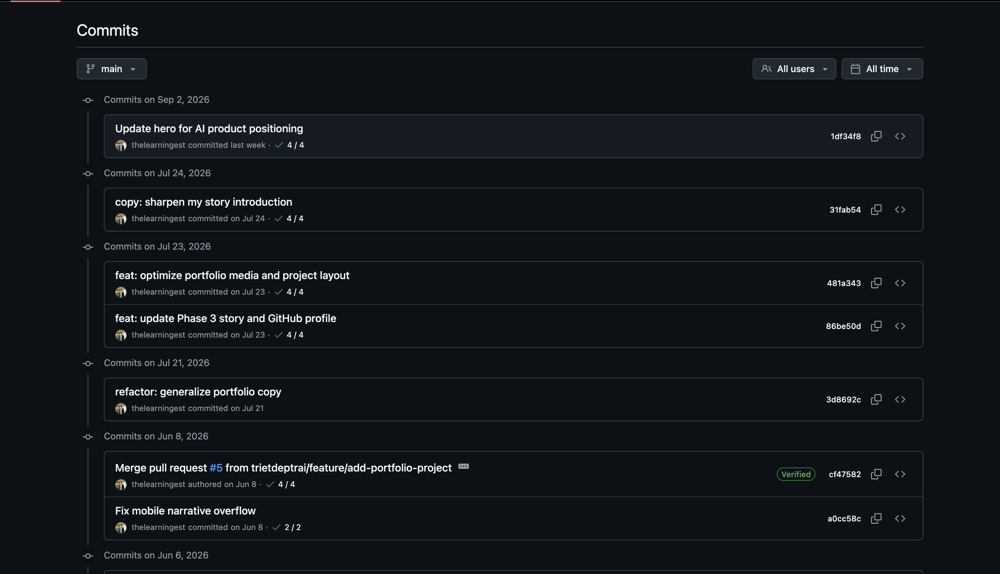
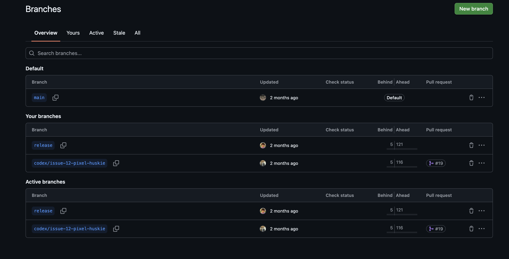

# Module 3 — Hiện thực hoá sản phẩm cùng coding agent

## Debug cùng coding agent

Okay, bây giờ bạn đã có một implementation plan và bắt đầu thực hiện nó. Đến giai đoạn này, có một điều mình chắc chắn bạn sẽ không thể tránh khỏi. Đó chính là gặp bug (lỗi phần mềm). Hiện tại coding agent chưa phát triển đến mức làm hoàn hảo mọi yêu cầu của bạn mà không có tí lỗi nào.

Thực ra hồi mới bắt đầu code với Coding agents, đâu đó tầm 40% thời gian mình dành để lên kế hoạch và xây sản phẩm thôi, 60% thời gian còn lại mình dành cho debugging (khắc phục lỗi). Thực ra hoàn thành tốt giai đoạn planning và implementation plan đã giúp bạn giảm khá khá bugs rồi. Nhưng vẫn khó tránh khỏi việc bạn sẽ gặp bug trong quá trình xây sản phẩm.

Vậy khi gặp bug thì xử lý thế nào?

### Khi lỗi xuất hiện trên màn hình

Khi gặp một bug có thể nhìn thấy trên màn hình, hãy chụp lại bug đó và gửi ảnh cho coding agent.

Đừng chỉ gửi ảnh. Hãy nói thêm bạn đang làm gì, bạn mong đợi điều gì và kết quả thực tế ra sao. Từ những thông tin này, agent có thể kiểm tra code, tìm nguyên nhân và giải thích lỗi bằng ngôn ngữ dễ hiểu trước khi sửa.

Sau khi agent sửa xong, hãy thực hiện lại đúng thao tác đã gây lỗi. Nếu lỗi không còn xuất hiện, chúng ta có thể tiếp tục.

Trên đây là ví dụ của một prompt bạn có thể áp dụng. Trong trường hợp này, lỗi có thể thấy ngay ở trên trang web, nên bạn chỉ việc cắt screenshot và nhắn prompt như trên là được.

### Khi ảnh chụp chưa cho thấy nguyên nhân

Đôi khi ảnh chụp chỉ cho thấy kết quả bị sai, nhưng chưa cho biết vì sao lỗi xảy ra.

Nếu bạn đã gửi ảnh lỗi mà agent vẫn chưa sửa được, bạn có thể yêu cầu agent thêm log, tức là thông tin ghi lại những hoạt động diễn ra khi ứng dụng đang chạy. Log có thể giúp agent có thêm thông tin về nguyên nhân gây ra lỗi, thay vì chỉ đoán mò

**Prompt mẫu:** “Hãy thêm log cần thiết để tìm nguyên nhân lỗi. Nếu cần tôi thực hiện lại thao tác gây lỗi, hãy hướng dẫn tôi. Sau khi sửa, hãy kiểm tra lại và xóa những log tạm không còn cần thiết.”

### Khi lỗi vẫn quay lại

Nếu lỗi vẫn quay lại sau nhiều lần sửa, hãy yêu cầu AI tạm dừng và liệt kê những nguyên nhân có thể khiến lỗi xảy ra. Cách này giúp quá trình điều tra có hệ thống hơn và thường tìm ra nguyên nhân gốc, thay vì chỉ vá những biểu hiện trước mắt.

Sau đó, hãy yêu cầu coding agent kiểm tra từng nguyên nhân và dựa vào bằng chứng để xác định nguyên nhân nào thực sự gây ra lỗi.

## Git và GitHub

### Vì sao cần Git?

Trong quá trình debugging, có thể bạn sẽ cần phải khôi phục phiên bản trước khi có lỗi, để xem lỗi nằm ở đâu. Đó là lúc Git có tác dụng

Git là một hệ thống quản lý phiên bản phân tán. Hệ thống quản lý phiên bản giúp ghi lại những thay đổi của dự án theo thời gian và cho phép quay lại một phiên bản trước đó khi cần.

### Git khác GitHub như thế nào?

Git và GitHub thường được nhắc đến cùng nhau, nhưng thực ra chúng là hai khái niệm khác nhau.

Git là một hệ thống hoạt động trên máy tính của bạn. Git theo dõi các tệp trong repository và lưu lại lịch sử thay đổi của chúng. Bạn có thể dùng Git mà không cần kết nối với GitHub.

GitHub là một nền tảng trực tuyến. Bạn có thể đưa repository từ máy tính lên GitHub để lưu thêm một bản trên mạng. Sau đó, bạn có thể truy cập dự án từ máy khác hoặc chia sẻ với người khác.

GitHub cũng cung cấp các công cụ giúp mọi người cùng thảo luận và quản lý công việc.

### Commit: lưu một phiên bản của dự án

Bây giờ, mình sẽ giới thiệu thêm một số khái niệm để bạn hiểu thêm về cách Git hoạt động.

Đầu tiên là Commit.

Về căn bản, Commit là một phiên bản của dự án mà bạn đã lưu lại tại một thời điểm cụ thể. Giả dụ sau khi bạn sửa xong hiệu ứng animation của portfolio thấy đẹp quá nên bạn muốn lưu nó lại để sau này nếu lỡ phá code thì vẫn tìm lại phiên bản cũ được. Commit sẽ giúp bạn làm điều đó.

Hình ở góc bên phải màn hình chính là git tree, biểu đồ để minh hoạ lịch sử của dự án. Các bạn có thể thấy mỗi chấm là một commit, và nhiều chấm nối lại với nhau tạo thành lịch sử phát triển dự án.

Các bạn nên tạo commit ngay sau mỗi thay đổi lớn trong dự án, hoặc thay đổi nào mà bạn thấy thích, để có thể tìm lại phiên bản đã lưu nếu lỡ sửa hỏng code. Bạn chỉ cần bảo agents là "commit all the current changes with appropriate messages" là được.

### Push: đưa commit lên GitHub

commit của dự án khi được push lên github

Khi bạn muốn chuyển một commit từ môi trường máy tính của bạn lên GitHub, bạn sẽ sử dụng lệnh 'git push' (cụ thể như nào thì bạn có thể nhờ agent làm). Sau khi push thành công, lịch sử commit của bạn cũng sẽ được lưu trên github và bạn có thể chia sẻ nó cho người khác.

### Branch: thử nghiệm mà không ảnh hưởng phiên bản ổn định

Một khái niệm nữa mà mình muốn giới thiệu cho bạn là **branch**, hay còn gọi là nhánh.

Giả sử portfolio của bạn đang hoạt động ổn, nhưng bạn muốn thử tạo thêm một khối 3D. Tính năng này khá phức tạp, và bạn chưa chắc làm xong có đẹp hay không. Nếu sửa trực tiếp trên nhánh chính, bạn có thể làm hỏng cả những phần đang chạy tốt.

Lúc này, bạn có thể tạo một branch riêng để phát triển tính năng 3D. Cứ hình dung đó là một “vùng riêng” để quậy. Những thay đổi bạn thực hiện và commit trên branch này sẽ không ảnh hưởng đến nhánh chính, cho đến khi bạn quyết định gộp chúng vào.

Nếu thử nghiệm không ổn, bạn có thể nhờ agent xử lý phần đang làm dở và quay lại nhánh chính. Bạn không bắt buộc phải đưa tính năng 3D vào portfolio, cũng không cần xóa branch ngay nếu muốn giữ lại để thử tiếp sau này.

Để bắt đầu, bạn chỉ cần bảo agent:

> Tạo và chuyển sang branch `feature/3d-development` (hoặc bất kỳ tên nào bạn thích) để phát triển tính năng 3D.

### Merge: gộp nhánh và xử lý xung đột

ảnh các branches trong một dự án trên github của mình

Sau khi đã xem và kiểm tra tính năng, nếu muốn đưa nó vào nhánh chính, bạn có thể bảo:

> Gộp branch hiện tại vào nhánh chính `main`. Nếu có xung đột, hãy giải thích và đề xuất cách xử lý để tôi quyết định. Sau khi gộp, kiểm tra lại tính năng một lần nữa để chắc không có lỗi gì xảy ra

Thao tác gộp nhánh này được gọi là **merge**.

Ngoài ra, khi merge hai nhánh lại với nhau, đôi khi sẽ có những vùng xung đột xảy ra. Ví dụ, file hiệu ứng 3D của nhanh a quy định khối 3D xoay sang trái, trong khi nhánh b sửa cùng dòng đó để khối 3D xoay sang phải. Git sẽ không biết phải chọn cái nào, khiến xung đột (conflict) xảy ra

Xử lý conflict là một chủ đề khá rộng nên mình sẽ không đi sâu trong khóa này. Tạm thời bạn có thể nhờ agent xử lý là sẽ ổn thoả trong 85% trường hợp.

## Thực hành: Đưa repo lên GitHub

### Đưa repo portfolio lên GitHub

Cuối phần Practice, sau khi đã có website chạy trên máy, bạn sẽ đưa repo portfolio thật lên GitHub. Bài này chuẩn bị cho bạn từng bước; hãy dùng lại các bước đó khi website đã sẵn sàng.

Repo là kho lưu code và lịch sử của dự án. Chọn đúng repo portfolio, không đưa cả thư mục chứa các dự án khác lên. Kết quả cần có là một đường link GitHub mở được và những commit bạn vừa lưu xuất hiện đúng branch.

Đưa repo lên GitHub chưa tạo ra đường link xem website. Module 4 sẽ dùng repo này để đưa website lên Vercel. Bạn có thể giữ repo Private, tức chỉ tài khoản được cấp quyền mới đọc được code.

### Kiểm tra trước lần push đầu

Nhờ agent kiểm tra đúng thư mục, branch hiện tại, các tệp định commit và nơi repo đang kết nối. Nơi kết nối đó gọi là remote; nếu dự án đã có remote, hãy xác nhận nó thuộc đúng tài khoản và dự án trước khi dùng.

Agent cần rà cả lịch sử Git để tránh đưa mật khẩu, mã truy cập dịch vụ hoặc dữ liệu khách hàng lên mạng. Mã truy cập dịch vụ thường được gọi là token; tệp .env là nơi dự án có thể lưu các cài đặt riêng, bao gồm những mã này. Tệp .gitignore giúp Git bỏ qua một số tệp ở những lần lưu sau; nó không xóa tệp đã commit trước đó. Nếu phát hiện mã bí mật đã lộ, dừng push và nhờ agent hướng dẫn thu hồi hoặc thay mã.

Yêu cầu agent tóm tắt phần sẽ đưa lên. Bạn không phải tự đọc code, nhưng cần hiểu các tệp đó chứa gì và có được phép chia sẻ không.

### Tạo repo trống trên GitHub

Tự đăng nhập GitHub bằng tài khoản của bạn. Mở github.com/new, kiểm tra Owner là đúng tài khoản và đặt Repository name dễ nhận biết, chẳng hạn my-portfolio.

Chọn Private nếu chỉ muốn lưu code cho mình và dịch vụ được cấp quyền. Chọn Public chỉ khi bạn đồng ý cho mọi người xem code và lịch sử. Bạn chưa cần Public để dùng Vercel.

Vì đã có dự án trên máy, hãy để repo mới trống: không bật các lựa chọn thêm tệp sẵn như README (giới thiệu dự án), .gitignore hoặc license (giấy phép sử dụng code) ở bước tạo. Bấm Create repository, rồi sao chép địa chỉ repo. Nếu repo đúng đã tồn tại, dùng repo đó sau khi agent kiểm tra thay vì tạo thêm một bản trùng.

### Nhờ agent nối repo và push

Gửi địa chỉ repo vừa tạo cho agent và nói:

“Hãy đối chiếu thư mục portfolio hiện tại với repo GitHub này. Sau khi kiểm tra các tệp và lịch sử, tóm tắt phần sẽ đưa lên, branch và chế độ Private/Public để tôi duyệt. Khi tôi đồng ý, hãy commit phần đã duyệt nếu cần, nối đúng remote và push branch đó. Không ghi đè lịch sử có sẵn bằng force-push.”

Nếu GitHub yêu cầu đăng nhập hoặc xác nhận quyền, bạn tự làm trên trang của dịch vụ. Không gửi mật khẩu hay mã xác nhận vào chat.

Nếu agent báo bị từ chối, nhờ kiểm tra tài khoản, quyền và remote. Đừng vội tạo repo mới hoặc cho phép ghi đè chỉ để bỏ qua lỗi.

### Tự xác nhận code đã lên GitHub

Mở địa chỉ repo trong trình duyệt sau khi agent báo push xong. Kiểm tra tên chủ sở hữu, tên repo, nhãn Private/Public và chọn đúng branch trong menu branch.

Mở danh sách commit, đối chiếu commit gần nhất bằng dãy ký tự nhận diện commit mà agent báo. Xem các tệp portfolio đã xuất hiện và không có tệp riêng tư ngoài dự kiến. Một commit chỉ nằm trên máy chưa phải đã lên GitHub.

Ghi lại link repo, branch, commit và chế độ truy cập để dùng ở Module 4. Trong Practice, hoàn thành bước này sau khi website trên máy đã được kiểm tra. Bạn có thể quay lại các trang hướng dẫn qua mục lục; phần tóm tắt tiếp theo vẫn nhắc lại các kiến thức Git vừa học.

Tài liệu đối chiếu: [GitHub — tạo repo mới](https://docs.github.com/en/repositories/creating-and-managing-repositories/creating-a-new-repository) và [đưa code có sẵn lên GitHub](https://docs.github.com/en/migrations/importing-source-code/using-the-command-line-to-import-source-code/adding-locally-hosted-code-to-github), xem ngày 14/09/2026.

## Tóm lại

4 điều cần nhớ trước khi bắt đầu Practice:

- Khi debug, đa số bạn chỉ cần chụp screenshot và mô tả kỹ lỗi của bạn cho agent là được. Nếu vẫn không được thì bảo agent add log vào terminal để xem lỗi là gì, paste cái log đó vào coding agent và bảo nó sửa lại lần nữa
- Bạn nên bảo agent hãy commit sau mỗi quyết định lớn, để sau này bạn sẽ dễ quay lại phiên bản cũ hơn nếu gặp bug.
- Mỗi khi muốn phát triển một tính năng mới, hãy tạo một branch mới để lỡ agent có quậy thì cũng không ảnh hưởng đến tính năng hiện tại. Bạn chỉ cần bảo agent tạo branch là nó sẽ tự động hướng dẫn cho bạn
- Bạn có thể tạo một tài khoản github rồi bảo agent push code hiện tại của bạn lên đó nếu bạn muốn hợp tác với một người khác

## Practice: Xây portfolio

Trong phần Practice này, bạn sẽ tiếp tục làm việc trong task Codex đã dùng ở Module 2. Codex sẽ dựa vào PRD và implementation plan đã được duyệt để bắt đầu xây website.

Codex sẽ thực hiện từng phần của plan. Sau mỗi phần, Codex giải thích những gì đã thay đổi và kiểm tra kết quả. Bạn sẽ xem website thực tế rồi quyết định tiếp tục hoặc yêu cầu chỉnh sửa.

Nếu gặp lỗi trong quá trình xây, hãy trao đổi ngay với Codex trong task đang thực hiện. Codex đã có bối cảnh của website và biết những thay đổi vừa được thực hiện.

Khi bạn hài lòng với website hiện tại, hãy bấm **Hoàn thành bài** ngay trên Teacher Triết.

## Đối chiếu repo trước bài tổng kết

Trước bài tổng kết, hãy mở repo GitHub thật và ghi lại link repo, branch, dãy ký tự nhận diện commit gần nhất cùng chế độ Private/Public. Đối chiếu với phiên bản portfolio trên máy. Nếu chưa push hoặc không khớp, quay lại task Codex để hoàn thành các bước GitHub đã học.

Khi học cùng Teacher, đưa các thông tin này để Teacher xem trước khi bắt đầu câu hỏi. Nút bên dưới là xác nhận bạn đã tự đối chiếu, không phải kết quả kiểm tra GitHub tự động.

Sau bước này, bạn sẽ trả lời năm câu hỏi về cách thực hiện plan, vai trò của Git và GitHub, dùng log, điều tra lỗi quay lại và thử nghiệm trên branch.

## Điều kiện hoàn thành

Course Companion kiểm tra các phần bắt buộc của website, kết quả kiểm tra hiện tại và bằng chứng trong workspace. Sau khi các phần này đã đầy đủ, bạn xem lại website lần cuối rồi xác nhận chấp nhận phiên bản hiện tại.

Cuối cùng, bạn trả lời năm câu hỏi tổng kết về cách thực hiện plan, báo lỗi, dùng log, điều tra lỗi quay lại và thử nghiệm trên branch.

## Nguồn phương pháp

- [OpenAI — Introducing Codex](https://openai.com/index/introducing-codex/)
- [Git — About Version Control](https://git-scm.com/book/en/v2/Getting-Started-About-Version-Control)
- [Git — What is Git?](https://git-scm.com/book/en/v2/Getting-Started-What-is-Git%3F)
- [Git — Branches in a Nutshell](https://git-scm.com/book/en/v2/Git-Branching-Branches-in-a-Nutshell)
- [GitHub — What is GitHub?](https://docs.github.com/en/get-started/start-your-journey/what-is-github)
- [GitHub — About remote repositories](https://docs.github.com/en/get-started/basics/about-remote-repositories)
