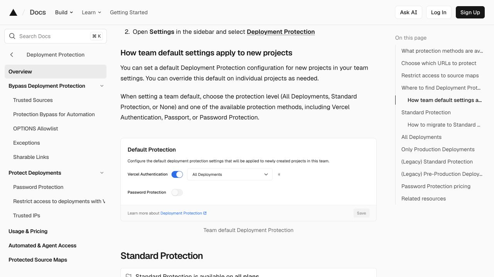
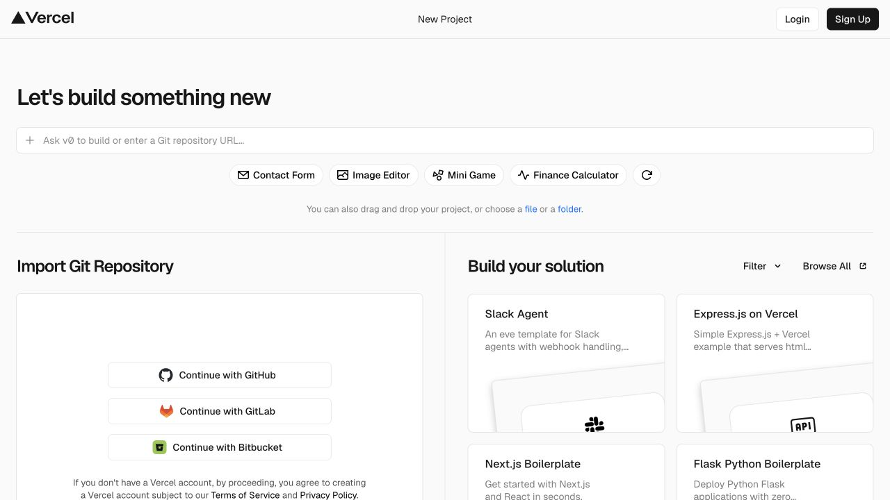
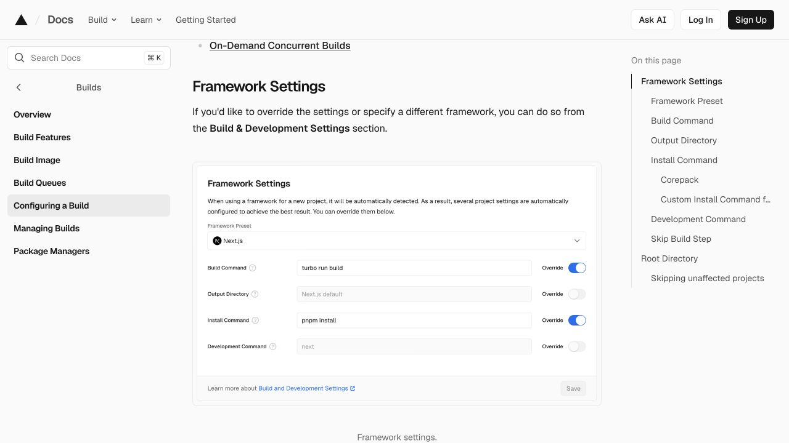

# Module 4 — Kiểm chứng, phát hành và chứng minh quyền sở hữu

## Hosting là gì?

Bạn đã làm xong portfolio và mở được nó trên máy. Bây giờ, bạn muốn gửi cho một người bạn xem. Nhưng đường dẫn `localhost` bạn đang dùng chỉ trỏ về máy đang mở nó, nên gửi đường dẫn này chưa giúp người kia xem được portfolio.

Bạn cần đặt website ở một nơi có thể truy cập qua Internet. Dịch vụ cung cấp nơi đó được gọi là **hosting**.

Khi website đã được đưa lên đó, người khác có thể mở bằng đường link, kể cả khi bạn đã tắt máy. Trong khóa học này, chúng ta sẽ dùng Vercel để làm việc đó.

## Máy tính, GitHub và Vercel làm gì?

Trong bài thực hành này, mỗi nơi có một vai trò:

| Nơi | Vai trò trong bài thực hành |
|---|---|
| Máy tính của bạn | Nơi bạn cùng agent xây và sửa portfolio. |
| GitHub | Nơi lưu code và lịch sử thay đổi của dự án trên mạng. |
| Vercel | Lấy code của dự án và đưa website lên để người khác truy cập. |

GitHub lưu code của bạn, còn Vercel giúp người khác mở website.

## Milestone 1 — Hosting, Vercel và bản chuẩn bị phát hành

### Vercel giúp bạn làm gì?

Ở Module 3, bạn đã đưa code lên GitHub. Vercel có thể lấy code từ đó, chuẩn bị website và cấp cho bạn một đường link để mở trên Internet. Bạn không phải tự vận hành một máy tính luôn bật để phục vụ người xem.

Điểm tiện là GitHub và Vercel có thể nối với nhau: khi bạn push một bản sửa, Vercel tạo bản triển khai mới. Bạn cũng có thể xem thử thay đổi trên một đường link riêng trước khi đưa vào website chính.

Trong module này, bạn sẽ nối repo, đưa portfolio lên Vercel, kiểm tra đường link và thử cập nhật một chi tiết nhỏ.

### Tiện, nhưng cần hiểu giới hạn

Vercel có gói Hobby miễn phí cho mục đích cá nhân, phi thương mại. Đừng mặc định mọi portfolio đều phù hợp với gói này: nếu website dùng để bán dịch vụ hay phục vụ khách hàng, hãy nhờ agent đối chiếu mục đích sử dụng với điều kiện hiện tại trước khi chọn gói.

Miễn phí vẫn có giới hạn sử dụng. Khi chạm giới hạn, một số tính năng có thể phải chờ chu kỳ tiếp theo. Với gói trả phí, bạn cần xem mục Usage và chi phí trước khi bật thêm dịch vụ.

Bạn cũng phụ thuộc vào dịch vụ và cách cấu hình của Vercel. Giữ code trên GitHub giúp bạn có bản để chuyển sang nơi khác, nhưng việc chuyển có thể cần chỉnh lại cấu hình. Khóa học chưa cần bạn mua tên miền hay thêm dịch vụ trả phí.

### Một portfolio, ba nơi để xem

Local là bản đang chạy trên máy bạn, thường mở bằng địa chỉ localhost. Bạn sửa và thử ở đây trước.

Preview là bản xem thử trên Internet. Ví dụ, bạn đổi phần giới thiệu trên một branch riêng rồi mở đường link Preview để kiểm tra.

Production là bản chính mà bạn muốn người xem sử dụng lâu dài. Khi bản mới được đưa vào Production, nội dung ở địa chỉ chính có thể thay đổi.

Ba tên này nói về vai trò của bản website. Chúng chưa cho biết ai được xem. Preview vẫn cần cài đặt quyền truy cập; Production cũng có thể được bảo vệ. Bạn sẽ chọn quyền này trước khi triển khai.

### Trước khi đưa website lên mạng

Trước hết, mở lại portfolio trên máy và bản yêu cầu đã duyệt ở Module 2. Website đã có đủ những phần bạn đồng ý làm chưa? Nội dung còn dòng mẫu, ảnh tạm hay kết quả chưa có bằng chứng không?

Nhờ agent chạy các kiểm tra của đúng dự án và giải thích kết quả. Với starter của khóa học, có thể dùng npm run check, rồi npm run preview để mở bản đã được chuẩn bị cho phát hành trên máy.

Chữ preview trong câu lệnh này vẫn chỉ bản trên máy, chưa phải Vercel Preview. Bạn không cần nhớ lệnh; hãy yêu cầu agent mở đúng bản để bạn xem.

### Thử như một người lần đầu ghé xem

Mở từng dự án, bấm các liên kết, xem ảnh và thử nút tải CV nếu có. Đọc lại tên, vai trò và thông tin liên hệ. Nếu nút Contact chỉ mở ứng dụng email, nó chưa gửi email thay bạn; nếu là biểu mẫu, cần kiểm tra việc nhận thư thật trước khi nói rằng nó hoạt động.

Xem portfolio ở cửa sổ máy tính và màn hình điện thoại. Thử dùng phím Tab để đi qua các liên kết, rồi Enter để mở. Chú ý chữ bị cắt, nút khó bấm và thứ tự di chuyển khó hiểu.

Ghi lại phần đã thử, lỗi còn lại và phần bạn chủ động chưa làm. Lỗi khiến người xem không hoàn thành việc chính cần được sửa và thử lại trước khi đưa lên mạng.

Sau phần này, trả lời một câu kiểm tra nhanh. Lời giải chỉ hiện sau khi bạn trả lời.

## Milestone 2 — Nội dung và quyền truy cập

### Nội dung nào được phép đưa lên mạng?

Hãy xem cả những tệp đi kèm website: CV có số điện thoại hoặc địa chỉ bạn không muốn công khai không? Ảnh dự án có thông tin khách hàng chưa được phép chia sẻ không? Một tệp không xuất hiện trong menu vẫn có thể được mở bằng đường link trực tiếp.

Nhờ agent kiểm tra code, các tệp sắp đưa lên và lịch sử Git xem có mật khẩu, token hay API key không. Token và API key là những mã có thể cho phép người khác sử dụng tài khoản hoặc dịch vụ của bạn; đừng dán chúng vào chat hay chụp trong ảnh hướng dẫn.

Nếu có mã đã bị lộ, dừng công bố và nhờ agent hướng dẫn thu hồi hoặc thay mã. Chỉ xóa tệp hiện tại hay thêm vào .gitignore chưa xóa được bản đã lưu trước đó.

Nếu portfolio có thêm đăng nhập, thanh toán, thu thập thông tin người xem hoặc biểu mẫu gửi dữ liệu đến một dịch vụ, hãy dừng để xem xét riêng cách xử lý dữ liệu và chi phí. Luồng cơ bản của bài này chưa bao gồm các tính năng đó.

### Repo riêng tư không làm website riêng tư

Private trên GitHub quyết định ai được xem repo. Quyền xem website được đặt riêng ở Vercel. Repo Private vẫn có thể tạo ra một website công khai.

Trong Vercel, Deployment Protection là phần giới hạn người truy cập. Vercel Authentication yêu cầu người xem đăng nhập bằng tài khoản có quyền phù hợp.

Standard Protection bảo vệ các bản triển khai, trừ địa chỉ Production chính. All Deployments bảo vệ cả địa chỉ đó. Nếu bạn chỉ muốn tự kiểm tra, hãy dùng Vercel Authentication với All Deployments.

Sau khi đặt quyền, luôn thử chính đường link định chia sẻ trong cửa sổ riêng tư của trình duyệt. Đừng suy ra website đã riêng tư chỉ từ tên cài đặt.

### Đặt quyền trước lần triển khai đầu

Đăng nhập Vercel bằng tài khoản của bạn. Chọn đúng khu vực quản lý dự án, được Vercel gọi là team. Trước khi tạo project mới, mở Settings của team, tìm Deployment Protection và phần Default Protection.

Trong hình: ① bật Vercel Authentication, ② chọn All Deployments, ③ bấm Save. Đây là quyền mặc định cho các project tạo sau đó; hãy kiểm tra lại trong project sau khi tạo.

Lần triển khai đầu tiên của project mới là Production, kể cả khi bạn định làm bản xem thử. Vì vậy, đừng bấm Deploy rồi mới đặt quyền. Nếu không thấy cài đặt như hình hoặc không có quyền đổi, dừng ở đây và nhờ agent đối chiếu màn hình của bạn.

Sau phần này, trả lời một câu kiểm tra nhanh. Lời giải chỉ hiện sau khi bạn trả lời.

## Milestone 3 — Đưa portfolio lên Vercel và tạo Preview

### Chuẩn bị lần triển khai đầu

Deploy nghĩa là đưa một phiên bản website lên dịch vụ hosting. Trên Vercel, mỗi lần như vậy tạo một deployment, tức một bản triển khai có thông tin riêng về code nguồn và kết quả.

Lần đầu, bạn sẽ tạo project từ repo GitHub và giữ Production được bảo vệ. Sau đó, bạn dùng một branch khác để tạo Preview và tập kiểm tra trước khi cập nhật website chính.

Chuẩn bị đường link repo ở Module 3, tên branch chứa bản đã kiểm tra và commit gần nhất. Nhờ agent tóm tắt thêm thư mục chứa website cùng cài đặt Vercel phù hợp. Nếu repo chưa có code trên GitHub, quay lại bài đưa repo lên GitHub trước.

### Mở trang tạo project

Mở vercel.com/new. Nếu chưa đăng nhập, chọn Continue with GitHub như vị trí ② trong hình, rồi tự đăng nhập trên trang của dịch vụ.

Nếu đã đăng nhập, tìm Import Git Repository ở vị trí ①. Đây là nơi lấy dự án có sẵn từ GitHub. Bạn không cần chọn một mẫu website mới ở bên phải vì đã có portfolio của mình.

Khi GitHub hỏi quyền kết nối, kiểm tra đúng tài khoản và chỉ chọn repo cần dùng nếu có lựa chọn đó. Không gửi mật khẩu hay mã xác nhận cho agent. Sau khi quay lại Vercel, tìm repo portfolio để tiếp tục.

### Chọn đúng repo

Trong danh sách Import Git Repository, tìm tên repo và tên tài khoản sở hữu đã ghi ở Module 3. Chọn Import bên cạnh đúng repo đó.

Nếu không thấy repo, kiểm tra bạn đang đăng nhập đúng tài khoản GitHub chưa. Sau đó, tìm Configure GitHub App để xem Vercel đã được phép truy cập repo này chưa. Không cần đổi repo thành Public chỉ để nó xuất hiện.

Ở màn hình tạo project, kiểm tra lại tài khoản Vercel, tên project và repo nguồn. Tên project có thể ảnh hưởng đến địa chỉ Vercel cấp cho website. Đặt tên dễ nhận biết; bạn chưa cần mua tên miền riêng.

### Để agent chuẩn bị cài đặt

Trước khi điền cài đặt, nhờ agent đọc dự án và ghi rõ giá trị phù hợp cho từng mục trên Vercel. Bạn chỉ cần đối chiếu với màn hình, không phải tự nhớ hay đoán.

Root Directory là thư mục bắt đầu của ứng dụng trong repo. Nếu repo còn chứa tài liệu khóa học hay nhiều ứng dụng, nhờ agent chỉ đúng thư mục portfolio.

Nếu Environment Variables xuất hiện, đó là phần cài đặt riêng cho ứng dụng. Portfolio đơn giản thường không cần thêm mã bí mật; hãy hỏi agent trước khi điền.

### Đối chiếu cài đặt với agent

Framework Preset là loại công cụ mà dự án dùng để tạo website. Build Command là lệnh chuẩn bị website để phát hành. Output Directory là thư mục chứa kết quả của lệnh đó. Ba vị trí tương ứng được đánh số trong hình.

Bạn không cần tự chọn theo trí nhớ. Nhờ agent đọc dự án và ghi rõ giá trị cần dùng cho từng mục, rồi đối chiếu với màn hình Vercel. Hình dùng một dự án ví dụ trong tài liệu; đừng chép các giá trị trong hình.

### Bấm Deploy và đọc kết quả

Trước nút Deploy, xác nhận đúng repo, cấu hình, phiên bản và quyền All Deployments đã lưu. Chỉ tiếp tục khi bạn đồng ý đưa các tệp đã kiểm tra lên Vercel.

Bấm Deploy. Vercel sẽ lấy code và tạo bản dựng, tức chuẩn bị các tệp để website chạy. Ready nghĩa là quá trình triển khai đã sẵn sàng; Error nghĩa là cần xem lỗi. Ready chưa chứng minh nội dung và mọi nút đều đúng.

Mở trang chi tiết bản triển khai. Đối chiếu branch và commit với bản bạn muốn đưa lên, rồi ghi lại đường link cùng môi trường Production. Kiểm tra lại Settings → Deployment Protection của project và thử quyền truy cập bằng cửa sổ riêng tư. Khi đã nối GitHub, những lần push tiếp theo cũng có thể tự tạo deployment.

### Tạo một Preview để tập cập nhật

Giờ hãy thử một thay đổi nhỏ, chẳng hạn sửa một câu giới thiệu. Trước khi sửa, nhờ agent xem Production Branch của project, tức branch Vercel dùng để cập nhật website chính. Branch này thường là main nhưng cần kiểm tra thực tế.

Yêu cầu agent tạo một branch khác, sửa đúng câu đó và mở bản Local cho bạn xem. Khi đã đồng ý, cho agent commit và push branch mới. Nêu rõ lần push này được phép tạo một Preview, chưa được merge vào Production Branch.

Mở project trên Vercel → Deployments. Chọn bản mới có môi trường Preview, đúng branch và commit. Nếu thấy Production, dừng để kiểm tra lại cấu hình trước khi tiếp tục. Tên branch mới không tự bảo đảm đó là Preview.

### Mở đúng bản rồi mới chấp nhận

Trong trang chi tiết deployment, kiểm tra ba điều: trạng thái Ready, môi trường Preview và commit đúng với bản vừa push. Sau đó mở đường link của chính deployment này.

Đọc lại câu vừa sửa và thử các phần liên quan. Kiểm tra trên máy tính, điện thoại và cửa sổ riêng tư như lúc kiểm tra Local. Nếu Preview được bảo vệ, người chưa có quyền phải gặp yêu cầu đăng nhập thay vì thấy nội dung.

Ghi đường link, commit, ngày kiểm tra, điều đã thử và lỗi còn lại. Một ảnh trang đầu hoặc câu “đã deploy xong” của agent chưa đủ. Nếu sửa tiếp và tạo commit mới, bạn cần kiểm tra Preview mới; kết quả của bản cũ không chứng minh bản mới.

Sau phần này, trả lời một câu kiểm tra nhanh. Lời giải chỉ hiện sau khi bạn trả lời.

## Milestone 4 — Công bố, cập nhật và khôi phục

### Bạn quyết định lúc nào công khai

Preview đã ổn chưa có nghĩa bạn phải công khai ngay. Bạn có thể giữ All Deployments để tiếp tục sửa, ghi lý do chưa công bố và việc cần làm tiếp.

Nếu muốn chia sẻ rộng rãi, hãy đọc bản tóm tắt ngắn: phiên bản nào sẽ lên website chính, nội dung gì được công khai, những gì đã kiểm tra, giới hạn còn lại và cách quay lại bản an toàn.

Bạn là người quyết định. Agent có thể đề xuất và làm phần kỹ thuật sau khi bạn đồng ý. Việc chuyển một bản sửa vào Production và việc mở quyền xem công khai là hai quyết định cần nói rõ.

### Đưa bản đã duyệt vào website chính

Với project nối GitHub, hãy nhờ agent xác nhận lại Production Branch. Sau khi bạn duyệt Preview, cho phép merge thay đổi vào branch đó và push. Nếu có xung đột, agent cần giải thích phần khác nhau để bạn chọn trước khi gộp.

Chờ deployment Production mới đạt Ready rồi kiểm tra commit và mở địa chỉ chính của project. Đừng chỉ xem lại link Preview. Nếu chưa muốn công khai, giữ All Deployments.

Khi đã quyết định cho mọi người xem, vào Settings → Deployment Protection của project và chọn phạm vi phù hợp, chẳng hạn Standard Protection để địa chỉ Production chính không yêu cầu đăng nhập. Chỉ thay quyền của đúng project, rồi kiểm tra đường link chính trong cửa sổ riêng tư.

### Kiểm tra sau khi công bố

Mở địa chỉ chính bằng cửa sổ riêng tư, nơi bạn chưa đăng nhập Vercel. Nếu muốn ai cũng xem được mà trang vẫn yêu cầu đăng nhập, hãy kiểm tra lại quyền và xem bạn có đang dùng nhầm link deployment không.

Thử lại ảnh, liên kết dự án, tải CV và cách liên hệ. Mở một trang con rồi tải lại trang; trang chủ chạy được chưa chứng minh mọi đường dẫn đều hoạt động. Xem trên điện thoại và thử Tab, Enter như trước.

Lưu địa chỉ chính cùng commit vừa phát hành vào ghi chú dự án. Chỉ đưa link vào CV hoặc hồ sơ cá nhân sau khi các bước này đạt. Nếu gặp lỗi chặn, ngừng chia sẻ thêm và xử lý hoặc khôi phục bản trước.

### Để đường link sẵn sàng chia sẻ

Nhờ agent kiểm tra tiêu đề tab, mô tả ngắn, biểu tượng nhỏ trên tab và ảnh đại diện khi dán link vào ứng dụng nhắn tin. Dùng thông tin thật, không để tên mẫu. Ảnh hoặc mô tả cũ có thể được ứng dụng nhắn tin lưu tạm nên không phải lúc nào cũng đổi ngay.

Địa chỉ dạng tên-project.vercel.app đã đủ để bắt đầu. Tên miền riêng, chẳng hạn tên-của-bạn.com, là lựa chọn thêm và thường có phí gia hạn. Nếu mua sau này, thêm tại Settings → Domains rồi làm theo đúng hướng dẫn của Vercel và nơi mua tên miền.

Website công khai không đồng nghĩa Google sẽ hiện ngay. Cũng đừng dùng “chưa tìm thấy trên Google” hay một đường link khó đoán để giữ bí mật nội dung.

### Muốn chỉnh portfolio thì làm thế nào?

Bạn có một dự án mới để thêm vào portfolio. Hãy mở đúng thư mục code trong Codex. Nếu task cũ không còn, tạo task mới ở thư mục này và cho agent đọc ghi chú dự án. Nói phần cần thêm, tư liệu thật và phần cần giữ nguyên.

Làm theo vòng quen thuộc: tạo branch riêng → sửa trên Local → xem và kiểm tra → commit, push để tạo Preview → duyệt Preview → merge, push vào Production Branch → kiểm tra website chính.

Việc sửa trên máy chưa làm website ngoài Internet thay đổi. Ngược lại, push vào Production Branch có thể tự cập nhật website chính. Vì vậy, đừng nói “push hết lên” khi bạn chỉ muốn thử một ý tưởng.

Mỗi lần chỉ nên thay một phần đủ nhỏ để bạn nhận ra điều gì đã đổi và biết quay lại đâu nếu gặp lỗi.

### Giao một lần sửa có điểm dừng

Bạn có thể nói với agent:

“Thêm dự án mới từ tư liệu tôi cung cấp. Trước khi sửa, kiểm tra đúng repo và Production Branch, rồi tạo branch khác. Giữ nguyên các phần còn lại. Mở bản Local và tóm tắt thay đổi để tôi xem. Khi tôi duyệt, hãy commit và push branch này để tạo Preview. Chưa merge hoặc cập nhật Production.”

Ở Preview, bạn kiểm tra nội dung mới và những phần có thể bị ảnh hưởng. Khi đã chấp nhận, mới cho phép cập nhật Production rồi thử lại địa chỉ chính.

Nếu website vẫn hiện bản cũ, đối chiếu commit trên GitHub và deployment trước. Kiểm tra đúng branch, trạng thái Ready và đúng đường link; tải lại trang chưa sửa được việc chưa push code.

### Khi Vercel báo lỗi

Nếu deployment báo Error, mở bản bị lỗi và phần Build Logs, tức nhật ký tạo bản dựng. Gửi agent đoạn lỗi liên quan, tên branch, commit và thao tác vừa làm; che mã bí mật nếu có. Yêu cầu agent nêu nguyên nhân có bằng chứng, sửa một phần nhỏ rồi thử lại.

Nếu báo Ready nhưng trang trống, ảnh mất hoặc đường dẫn báo 404, hãy chụp màn hình kèm đúng URL và cách tái hiện. Agent cần so sánh với bản Local, kiểm tra cấu hình và đường dẫn tệp.

Nếu không thấy deployment mới, xem commit đã lên đúng branch GitHub và Vercel còn quyền đọc repo không. Không cần tạo một project mới mỗi lần lỗi. Mọi lần sửa vẫn cần kiểm tra lại bản mới trước khi chia sẻ.

### Khi cần quay lại bản đang hoạt động

Rollback là đưa website chính trở lại một deployment trước đó. Nếu bản mới làm nút liên hệ hỏng, bạn có thể dùng cách này để người xem tạm dùng lại bản đã ổn.

Mở project → Deployments, tìm bản Production đã kiểm tra trước đó. Mở menu của bản đó và chọn Instant Rollback nếu khả dụng. Kiểm tra đúng bản và xác nhận, rồi mở lại địa chỉ chính để thử. Gói Hobby chỉ cho quay lại bản Production ngay trước; nếu không có bản phù hợp, nhờ agent sửa và triển khai bản mới.

Rollback trên Vercel không tự sửa code trên GitHub. Nhờ agent đưa phần sửa lỗi vào code và kiểm tra lại trước lần phát hành tiếp theo, nếu không lỗi có thể quay lại. Rollback cũng không thu hồi được tệp đã bị tải về hay mã bí mật đã lộ.

### Tiếp tục phát hành sau khi khôi phục

Sau Instant Rollback, Vercel tạm ngừng tự gắn các bản mới vào địa chỉ Production chính. Vì vậy, push bản đã sửa chưa chắc làm địa chỉ chính đổi ngay.

Sửa code cùng agent, kiểm tra Local và Preview, rồi tạo bản đã sửa trên Production Branch. Khi đã sẵn sàng, mở trang tổng quan project, chọn Undo Rollback, đối chiếu và chọn đúng deployment đã sửa, rồi xác nhận. Đây là một lần thay đổi website chính nên cần bạn đồng ý.

Mở lại địa chỉ chính để kiểm tra. Vercel sẽ bật lại việc tự cập nhật địa chỉ Production cho những lần push tiếp theo. Ghi lại commit đã sửa và kết quả để không nhầm bản vừa khôi phục với bản đã giải quyết nguyên nhân lỗi.

Sau phần này, trả lời một câu kiểm tra nhanh. Lời giải chỉ hiện sau khi bạn trả lời.

## Milestone 5 — Làm chủ portfolio và áp dụng cho dự án khác

### Bạn cần nắm gì về portfolio của mình?

Bạn không cần tự viết mọi dòng code để làm chủ portfolio. Bạn cần chỉ được repo nằm ở đâu, website chính dùng đường link nào, bản đang chạy lấy từ commit nào và ai có quyền quản lý tài khoản GitHub và Vercel.

Hãy tự giải thích một quyết định của bạn: vì sao chọn nội dung đó, bạn đã kiểm tra bằng cách nào, hoặc bằng chứng nào khiến bạn yêu cầu agent sửa lại. Nếu chưa biết câu trả lời, mở lại dự án và xem cùng agent.

Lời giải thích dựa trên việc bạn đã làm có giá trị hơn một đoạn tổng kết do agent viết hộ. Giữ lại cả giới hạn chưa giải quyết để lần cập nhật sau có điểm bắt đầu rõ ràng.

### Lưu lại để lần sau tiếp tục được

Tạo một ghi chú ngắn trong dự án: link repo, tên project Vercel, địa chỉ chính, Production Branch, commit đang chạy, cách mở Local, cách tạo Preview và bản có thể khôi phục.

Thêm những việc còn lại, nơi sửa nội dung và các lần gia hạn cần nhớ nếu bạn mua tên miền hoặc dùng gói trả phí. Ghi chú giúp cả bạn trong vài tháng tới và người hỗ trợ sau này tiếp tục được công việc.

Tài khoản GitHub, Vercel và tên miền nên thuộc quyền quản lý của bạn. Bật xác thực hai bước nếu có và giữ thông tin khôi phục ở nơi riêng tư. Không ghi mật khẩu, token hay mã khôi phục trong repo.

### Thử áp dụng cho một việc khác

Chọn một ứng dụng nhỏ khác portfolio, chẳng hạn một trang giúp bạn sắp xếp sách muốn đọc. Chưa cần xây ứng dụng đó.

Viết bằng lời của bạn: ai sẽ dùng, họ đang gặp khó khăn gì, phiên bản đầu cần giúp họ làm được một việc nào và bạn sẽ thử để biết nó hoạt động ra sao.

Sau đó, giao cho agent một nhiệm vụ đầu tiên có giới hạn: tìm hiểu dự án và đề xuất cách làm, nêu phần chưa làm, cách kiểm tra và lúc phải dừng để bạn duyệt. Dùng cùng cách xác định yêu cầu, làm từng phần và xem bằng chứng mà bạn đã áp dụng cho portfolio.

Sau phần này, trả lời một câu kiểm tra nhanh. Lời giải chỉ hiện sau khi bạn trả lời.

## Thực hành và kết quả cần giữ lại

Thực hành trên repo và tài khoản của bạn. Giữ lại các kết quả sau:

1. Bản kiểm tra trước phát hành: yêu cầu đã đạt, thao tác đã thử và giới hạn còn lại.
2. Repo, branch, commit, cài đặt quyền truy cập và quyết định đưa nội dung lên Vercel.
3. Bản triển khai đầu được bảo vệ và một Preview đã kiểm tra, gồm URL, commit, trạng thái và quan sát thực tế.
4. Quyết định có công khai địa chỉ chính hay chưa. Nếu công khai, thử lại bằng cửa sổ riêng tư.
5. Một thay đổi nhỏ đi qua Local và Preview. Chỉ cập nhật Production khi bạn đã duyệt; ghi cách khôi phục và tiếp tục phát hành.
6. Ghi chú để tiếp tục quản lý portfolio và bản kế hoạch đầu tiên cho một ứng dụng khác.

Preview đã kiểm chứng là điều kiện bắt buộc của bài thực hành dự kiến. Công khai Production là lựa chọn của bạn. Trong luồng import này, Vercel vẫn tạo deployment Production đầu tiên nhưng bạn giữ nó được bảo vệ; điều đó khác với cho mọi người xem website.

Bạn không cần gây lỗi hoặc rollback website thật để làm bài. Chỉ ra bản có thể khôi phục và giải thích các bước là đủ ở phần nội dung này.

## Kiểm tra cuối bài

Trả lời lần lượt sáu tình huống và hai câu tự viết trong bài kiểm tra Module 4. Hai câu tự viết phải dùng quyết định và bằng chứng của chính bạn, không chép ví dụ trong bài.

## Trạng thái bản duyệt nội dung

Phiên bản này chỉ để đọc và thử câu hỏi. Bài thực hành phát hành chưa hoạt động, nên xem hết nội dung chưa được tính là hoàn thành. Khi bài thực hành được mở, bạn sẽ dùng repo, tài khoản và portfolio của chính mình.

## Tài liệu để đối chiếu khi cần

Các bước và hình được đối chiếu ngày 14/09/2026. Giao diện có thể thay đổi; hãy đọc tên mục và kiểm tra dự án thật trước khi làm theo. Ảnh trong bài không chứng minh portfolio của bạn đã triển khai thành công.

- [Vercel: bắt đầu và import từ dashboard](https://vercel.com/docs/getting-started-with-vercel).
- [Vercel: Local, Preview, Production và lần triển khai đầu](https://vercel.com/docs/deployments/environments).
- [Vercel: gói Hobby](https://vercel.com/docs/plans/hobby).
- [Vercel: quyền truy cập và quyền mặc định](https://vercel.com/docs/deployment-protection).
- [Vercel: cài đặt bản dựng](https://vercel.com/docs/builds/configure-a-build).
- [Vercel: nối GitHub và tự triển khai khi push](https://vercel.com/docs/git/vercel-for-github).
- [Vercel: đọc nhật ký lỗi bản dựng](https://vercel.com/docs/deployments/logs).
- [Vercel: khôi phục và Undo Rollback](https://vercel.com/docs/instant-rollback).
- [Vercel: thêm tên miền](https://vercel.com/docs/domains/working-with-domains/add-a-domain).
